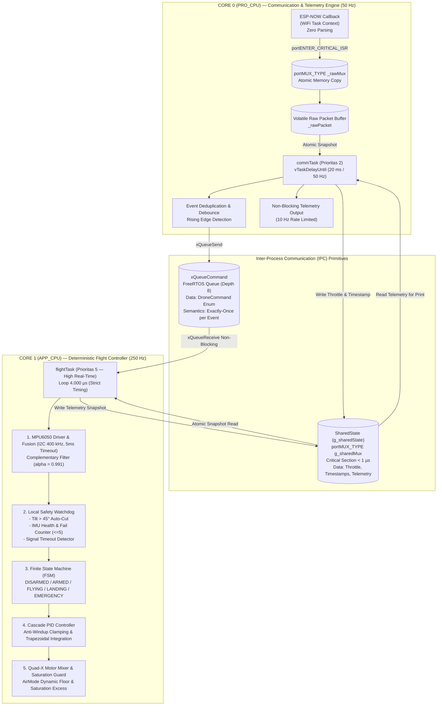
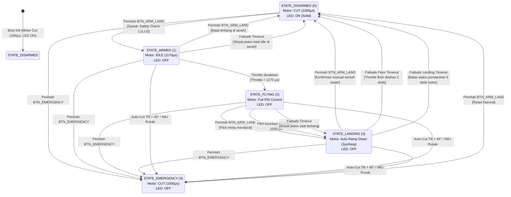
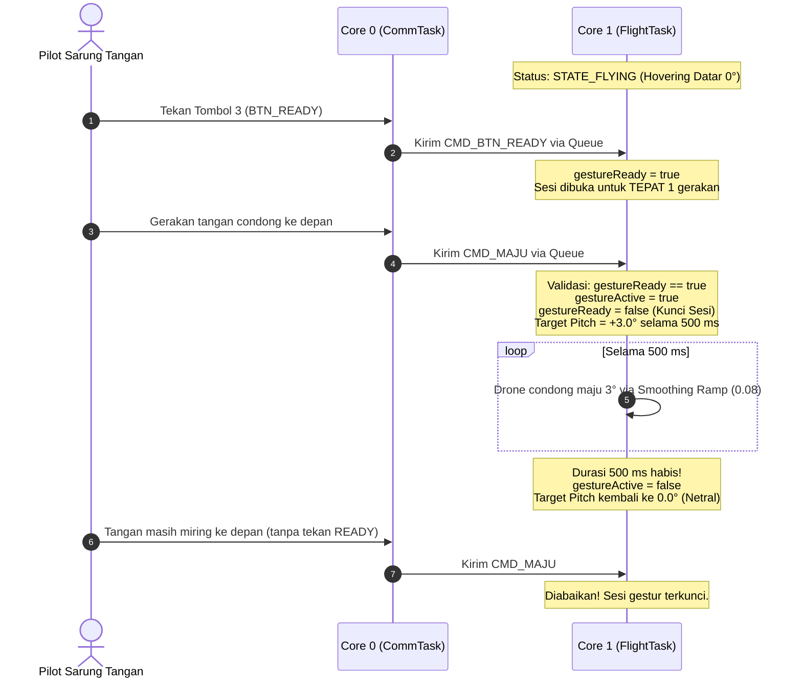
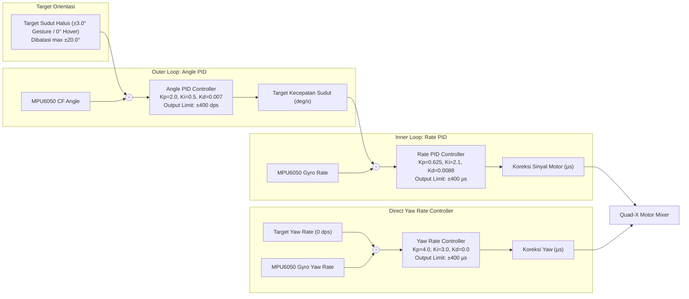
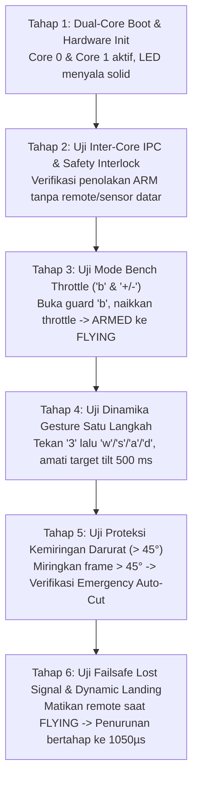

# Arsitektur & Spesifikasi Sistem Quadcopter F450 (Dual-Core FreeRTOS)

> **Dokumen Audit Teknis & Spesifikasi Implementasi**  
> Dokumen ini mendokumentasikan arsitektur firmware dual-core ESP32, rincian protokol komunikasi, penanganan multithreading FreeRTOS, estimasi sikap IMU MPU6050, kontroler Cascade PID, mixer motor Quad-X, dan mitigasi keselamatan penerbangan.  
> Setiap modul dan fitur diberi label status implementasi yang jelas:
> - `[IMPLEMENTED & BENCH-VERIFIED]` : Sudah diimplementasikan dan diverifikasi kompilasi serta logikanya di lingkungan bench test software.
> - `[HARDWARE-DEPENDENT / UNTESTED IN FLIGHT]` : Sudah dikodekan tetapi gain kendali, respons thrust, dan dinamika terbang fisiknya belum divalidasi pada pengujian terbang aktual.
> - `[DESIGN LIMITATION / KNOWN TRADE-OFF]` : Batasan rancangan perangkat keras atau algoritma yang didokumentasikan beserta risikonya.

---

## Daftar Isi
1. [Ikhtisar Sistem & Spesifikasi Perangkat Keras](#1-ikhtisar-sistem--spesifikasi-perangkat-keras)
2. [Arsitektur Multitasking Dual-Core FreeRTOS & Sinkronisasi IPC](#2-arsitektur-multitasking-dual-core-freertos--sinkronisasi-ipc)
3. [Pinout Hardware & Skema Rangkaian Elektrik](#3-pinout-hardware--skema-rangkaian-elektrik)
4. [Finite State Machine (FSM) & Prosedur Keselamatan](#4-finite-state-machine-fsm--prosedur-keselamatan)
5. [Glove Controller & Logika Gerakan Satu Langkah (Gesture Step)](#5-glove-controller--logika-gerakan-satu-langkah-gesture-step)
6. [Protokol Komunikasi Data (ESP-NOW & Serial Interface)](#6-protokol-komunikasi-data-esp-now--serial-interface)
7. [Sensor IMU MPU6050 & Estimasi Sikap (Attitude Estimation)](#7-sensor-imu-mpu6050--estimasi-sikap-attitude-estimation)
8. [Skema Kendali Dual-Loop Cascade PID](#8-skema-kendali-dual-loop-cascade-pid)
9. [Motor Mixing & ESC Driver (Quad-X Configuration)](#9-motor-mixing--esc-driver-quad-x-configuration)
10. [Peta Komponen Kode Sumber (Codebase Architecture)](#10-peta-komponen-kode-sumber-codebase-architecture)
11. [Protokol Pengujian Meja (Bench Test) & Diagnostik Sistem](#11-protokol-pengujian-meja-bench-test--diagnostik-sistem)

---

## 1. Ikhtisar Sistem & Spesifikasi Perangkat Keras

Quadcopter F450 ini dikendalikan oleh mikrokontroler **ESP32 DevKit V1** (arsitektur dual-core Xtensa LX6 32-bit, clock frekuensi 240 MHz). Drone menerima instruksi penerbangan nirkabel dari sarung tangan pintar (**Glove Controller**) berbasis **ESP32-C3** melalui protokol **ESP-NOW** (2.4 GHz tanpa perantara router WiFi).

### Filosofi Desain Sistem
1. **Asymmetric Multiprocessing (AMP) Decoupling** `[IMPLEMENTED & BENCH-VERIFIED]`:  
   Pemisahan tugas komunikasi nirkabel/IO pada **Core 0** dan tugas komputasi kendali terbang real-time pada **Core 1**.
2. **Determinisme Flight Loop 250 Hz (4.000 µs)** `[IMPLEMENTED & BENCH-VERIFIED]`:  
   Loop kendali Core 1 dijaga agar bebas dari operasi I/O serial yang memblokir (*blocking UART*), pemanggilan I2C tanpa batas waktu, atau *context switch jitter*.
3. **Fail-Safe First** `[IMPLEMENTED & BENCH-VERIFIED]`:  
   Failsafe beroperasi lokal pada Core 1. Jika komunikasi dengan Core 0 terhenti atau sinyal remote hilang saat terbang, drone memasuki fase pendaratan terkendali dengan *timer cut-off* otomatis.
4. **Step-by-Step Gesture Execution** `[IMPLEMENTED & BENCH-VERIFIED]`:  
   Sistem mengunci pembacaan gestur tangan pilot: **1 penekanan tombol READY = 1 langkah gerak terukur (500 ms)**, kemudian otomatis kembali ke orientasi sikap netral (0°).

### Tabel Ringkasan Spesifikasi Teknis
| Komponen / Parameter | Spesifikasi / Konfigurasi | Status Implementasi | Keterangan Teknis |
|---|---|---|---|
| **Mikrokontroler** | ESP32-WROOM-32 (DevKit V1) | Terpasang | Dual Core @ 240 MHz, 320 KB SRAM |
| **Sistem Operasi** | FreeRTOS (ESP-IDF / Arduino Core) | Terpasang | Preemptive multitasking antar-core |
| **Flight Task (Core 1)** | **250 Hz** (periode 4.000 µs, Prioritas 5) | `[IMPLEMENTED]` | IMU, Cascade PID, FSM, Safety Watchdog, ESC |
| **Comm Task (Core 0)** | **50 Hz** (periode 20 ms, Prioritas 2) | `[IMPLEMENTED]` | ESP-NOW, Serial parser, Deduplikasi, Telemetri |
| **Radio Receiver** | ESP-NOW 2.4 GHz (Kanal 1) | `[IMPLEMENTED]` | Latensi transmisi paket < 3 ms |
| **Sensor IMU** | InvenSense MPU6050 (6-Axis) | `[IMPLEMENTED]` | I2C Fast-Mode 400 kHz, Timeout 5 ms (Max 5x Fail Tolerance) |
| **Gyroscope Range** | ±500°/s (65.5 LSB/(°/s)) | `[IMPLEMENTED]` | DLPF Hardware ~44 Hz (Reg 0x1A = 0x03) |
| **Accelerometer Range**| ±8g (4096 LSB/g) | `[IMPLEMENTED]` | Reg 0x1C = 0x10 |
| **Attitude Fusion** | Complementary Filter ($\alpha = 0.991$) | `[IMPLEMENTED]` | Clamping sudut aktual $\pm 85^\circ$ |
| **Arsitektur Kendali** | Cascade PID (Dual-Loop) | `[IMPLEMENTED / UNTESTED IN FLIGHT]` | Outer Loop: Angle, Inner Loop: Rate |
| **Driver ESC** | Hardware PWM 500 Hz (LEDC) | `[IMPLEMENTED]` | Rentang pulsa: 1000 µs (Cut) s.d. 1999 µs |
| **Frame & Mixer** | Quad-X (M1 FR, M2 RR, M3 RL, M4 FL) | `[IMPLEMENTED]` | Dilengkapi AirMode Saturation Management |

---

## 2. Arsitektur Multitasking Dual-Core FreeRTOS & Sinkronisasi IPC



### Rincian Alokasi Tugas & Mekanisme Sinkronisasi

#### 1. Core 0 (`commTask`, Prioritas 2)
* **Tanggung Jawab**:
  1. Menerima callback paket radio dari stack Wi-Fi ESP-NOW. Callback ini dijalankan pada context Wi-Fi task dan hanya melakukan penyalinan mentah 3–4 byte ke buffer `_rawPacket` di bawah proteksi spinlock `_rawMux`.
  2. Memvalidasi struktur paket (apakah paket 3-byte `DronePacket` atau paket 4-byte `DronePacketV2` dengan Sequence Number).
  3. Mencegah eksekusi berulang (*event deduplication*) untuk perintah tombol mekanik (ARM, EMERGENCY, READY). Perintah tombol hanya dikirim ke antrean pada perubahan status (*rising edge*) atau setelah jeda debounce (`BUTTON_DEBOUNCE_MS = 250 ms`).
  4. Menerima input Serial Monitor untuk bench testing yang dilindungi oleh kunci keamanan toggle (`'b'`).
  5. Menangani pencetakan telemetri serial pada frekuensi 10 Hz secara non-blocking sehingga Core 1 tidak pernah tertahan oleh antrean buffer UART.

#### 2. Core 1 (`flightTask`, Prioritas 5)
* **Tanggung Jawab**:
  1. Mengeksekusi loop kalkulasi kendali dengan periode target **4.000 µs (250 Hz)**.
  2. Menghitung durasi siklus loop aktual (`dt`), waktu komputasi aktif, serta deviasi jitter dan deadline miss.
  3. Menarik perintah diskrit dari `xQueueCommand` secara non-blocking (`ticksToWait = 0`).
  4. Menyalin data throttle dan timestamp penerimaan paket secara atomik via `g_sharedMux` (< 1 µs).
  5. **Membaca IMU terlebih dahulu (`imu.update(dt)`)**: Membaca MPU6050 dengan batas timeout I2C 5 ms, memperbarui fusi sudut, dan memverifikasi kesehatan sensor secara real-time pada siklus berjalan.
  6. **Mengevaluasi Safety & State Machine**: Memeriksa batas kemiringan darurat ($> 45^\circ$) dan failsafe sinyal dengan data sensor paling segar, serta mereset sudut `smoothPitch` / `smoothRoll` ke 0 saat transisi `DISARMED`/`ARMED`.
  7. **Menghitung Dua Tahap Kendali Cascade PID**: Dilengkapi integrasi trapesium dan *clamping anti-windup* agar I-term tidak jenuh saat batas aktuator tercapai.
  8. **Mendistribusikan Pulsa Mixer Quad-X**: Menjalankan *AirMode saturation management* dengan *dynamic landing floor* sehingga thrust dapat benar-benar turun saat pendaratan tanpa kehilangan otoritas sikap.
  9. Memperbarui struct `TelemetryData` ke memori bersama secara atomik untuk dilaporkan oleh Core 0.

---

## 3. Pinout Hardware & Skema Rangkaian Elektrik

### Pemetaan Pin GPIO ESP32 DevKit V1
```
                         ESP32 DEVKIT V1 (30 PIN)
                              +------------+
                              |    USB     |
                              | [ESP-WROOM]|
                       EN ----|            |---- GPIO 23
                  GPIO 36 ----|            |---- GPIO 22 (I2C SCL -> MPU6050)
                  GPIO 39 ----|            |---- GPIO 1  (TX0 UART Telemetry)
                  GPIO 34 ----|            |---- GPIO 3  (RX0 UART Command)
                  GPIO 35 ----|            |---- GPIO 21 (I2C SDA -> MPU6050)
                  GPIO 32 ----|            |---- GPIO 19
  (Rear-Right)    GPIO 33 ----|            |---- GPIO 18
  (Front-Right)   GPIO 25 ----|            |---- GPIO 5
  (Front-Left)    GPIO 27 ----|            |---- GPIO 17
                  GPIO 14 ----|            |---- GPIO 16
  (Rear-Left)     GPIO 12 ----|            |---- GPIO 4
                  GPIO 13 ----|            |---- GPIO 0
                      GND ----|            |---- GPIO 2
                      VIN ----|            |---- GPIO 15 (LED Indikator)
                              +------------+
```

### Tabel Rincian Pinout & Spesifikasi Sinyal
| Komponen | Pin ESP32 | Mode Perangkat | Sinyal / Protokol | Catatan Elektrikal |
|---|---|---|---|---|
| **Motor 1 (Front-Right)**| **GPIO 25** | LEDC Timer 1 | PWM 500 Hz (1000–1999 µs) | Putaran CCW (Baling-baling R) |
| **Motor 2 (Rear-Right)** | **GPIO 33** | LEDC Timer 3 | PWM 500 Hz (1000–1999 µs) | Putaran CW (Baling-baling Standar) |
| **Motor 3 (Rear-Left)**  | **GPIO 12** | LEDC Timer 2 | PWM 500 Hz (1000–1999 µs) | Putaran CCW (Baling-baling R) |
| **Motor 4 (Front-Left)** | **GPIO 27** | LEDC Timer 0 | PWM 500 Hz (1000–1999 µs) | Putaran CW (Baling-baling Standar) |
| **MPU6050 SDA**         | **GPIO 21** | I2C Open-Drain | Data Bus I2C Fast-Mode | Memerlukan resistor pull-up 4.7 kΩ ke 3.3V |
| **MPU6050 SCL**         | **GPIO 22** | I2C Open-Drain | Clock Bus I2C 400 kHz | Memerlukan resistor pull-up 4.7 kΩ ke 3.3V |
| **Indikator Status LED**| **GPIO 15** | GPIO Output | Active-HIGH Logic | Menyala solid saat `DISARMED`, padam saat aktif |

---

## 4. Finite State Machine (FSM) & Prosedur Keselamatan

### Diagram State Machine Lengkap



### Lapis Perlindungan Keselamatan (Safety Interlocks)

#### 1. Validasi Pra-ARM (`safetyCheckPass`)
Sebelum motor diizinkan berputar pada batas idle, firmware memverifikasi 3 parameter:
1. **Integritas Sensor IMU**: `imu.isHealthy() == true`, sudut roll dan pitch bukan NaN, serta orientasi awal drone berada pada permukaan datar ($|\text{Roll}| < 30^\circ$ dan $|\text{Pitch}| < 30^\circ$).
2. **Konektivitas Remote**: Sinyal remote telah diterima secara valid dan waktu paket terakhir $< 1000\text{ ms}$.
3. **Posisi Throttle Remote**: Data throttle fisik remote dari paket harus berada pada posisi minimum ($\le \text{PWM\_IDLE} + 50 = 1220\text{ µs}$). Ini mencegah drone langsung terbang mendadak saat di-arm.

#### 2. Auto-Cut Kemiringan Darurat (> 45°) & Kegagalan IMU
Jika drone mengalami benturan keras, terbalik, atau sensor MPU6050 mengalami kegagalan I2C berturut-turut saat dalam status `ARMED`, `FLYING`, atau `LANDING`, firmware seketika memotong seluruh sinyal motor ke `1000 µs` (`STATE_EMERGENCY`) untuk mencegah kerusakan motor BLDC atau luka fisik akibat propeller liar.

> [!WARNING]
> **Trade-Off Risiko:** Pemotongan motor saat kemiringan $> 45^\circ$ akan menyebabkan drone jatuh bebas (*free-fall*). Tindakan ini sengaja dipilih karena menerbangkan drone dengan kemiringan $> 45^\circ$ atau sensor IMU rusak tanpa kontrol pilot akan memicu *flyaway* yang jauh lebih berbahaya.

#### 3. Logika Failsafe & Controlled Landing Tanpa Sensor Ketinggian
* **Jika Sinyal Hilang saat `ARMED`**: Drone langsung masuk ke `STATE_DISARMED`. Karena drone masih berada di tanah pada putaran idle floor, motor langsung dimatikan tanpa proses pendaratan.
* **Jika Sinyal Hilang saat `FLYING`**: Drone masuk ke `STATE_LANDING`:
  - Target kemiringan dikunci datar ($0.0^\circ$) dengan PID tetap menstabilkan frame.
  - Throttle diturunkan bertahap dengan laju $2\text{ µs/loop}$ (~500 µs/detik) menuju dasar landing $1050\text{ µs}$.
  - **Failsafe Timer Cutoff**: Karena drone tidak memiliki sensor ketinggian (sonar/barometer/LiDAR), firmware mengaktifkan pengaman waktu:
    1. Jika throttle telah mencapai dasar ($1050\text{ µs}$) dan tertahan selama **2.000 ms** (`FAILSAFE_FLOOR_HOLD_MS`), motor otomatis dimatikan (`STATE_DISARMED`).
    2. Jika dalam **6.000 ms** (`FAILSAFE_LANDING_TIMEOUT_MS`) pilot tidak menekan konfirmasi manual, motor otomatis dimatikan.

---

## 5. Glove Controller & Logika Gerakan Satu Langkah (Gesture Step)

Remote pengendali menggunakan 3 tombol fisik dan 1 sensor IMU pendeteksi gestur tangan.

### Tabel Perilaku Tombol Kontekstual (`BTN_ARM_LAND`)
| Status Drone Saat Ditekan | Aksi yang Dijalankan | Status Baru | Keterangan Operasional |
|---|---|---|---|
| `STATE_DISARMED` | **ARM** | `STATE_ARMED` | Menjalankan safety check (sudut datar, remote online, throttle low). |
| `STATE_ARMED` | **DISARM** | `STATE_DISARMED` | Membatalkan persiapan terbang sebelum throttle dinaikkan. |
| `STATE_FLYING` | **LAND** | `STATE_LANDING` | Memulai penurunan throttle bertahap. |
| `STATE_LANDING` | **CONFIRM** | `STATE_DISARMED` | Konfirmasi manual pilot bahwa drone telah mendarat di tanah. |
| `STATE_EMERGENCY` | **RESET** | `STATE_DISARMED` | Memulihkan sistem dari kondisi darurat ke kondisi aman. |

### Mesin Gestur Satu Langkah (Single-Step Gesture Engine)


* **Target Sudut Gestur (`GESTURE_TILT_ANGLE`)**: **$\pm 3.0^\circ$**
* **Durasi Gestur (`GESTURE_STEP_DURATION_MS`)**: **$500\text{ ms}$**
* **Filter Smoothing Ramping (`TILT_RAMP_RATE`)**: **$0.08\text{ per loop}$**  
  $$\text{SmoothAngle}_k = \text{SmoothAngle}_{k-1} + (\text{TargetAngle} - \text{SmoothAngle}_{k-1}) \times 0.08$$

---

## 6. Protokol Komunikasi Data (ESP-NOW & Serial Interface)

### 1. Struktur Paket Biner ESP-NOW
Firmware mendukung format paket biner standar 3-byte serta paket V2 4-byte dengan nomor urut:

```cpp
// Format Standar (3 bytes)
struct __attribute__((packed)) DronePacket
{
    uint8_t  command;      // DroneCommand enum
    uint16_t throttle;     // Throttle (1000 - 1800 µs, Little-Endian)
};

// Format V2 dengan Sequence Counter (4 bytes)
struct __attribute__((packed)) DronePacketV2
{
    uint8_t  seq;          // Nomor urut transmisi (0 - 255)
    uint8_t  command;      // DroneCommand enum
    uint16_t throttle;     // Throttle (1000 - 1800 µs, Little-Endian)
};
```

#### Pemetaan Nilai Enum Command (`DroneCommand`)
| Nilai Desimal | Identitas Enum | Fungsi Perintah |
|---|---|---|
| `0` | `CMD_NONE` | Heartbeat paket (hanya perbarui throttle & reset timer sinyal) |
| `1` | `CMD_MAJU` | Gestur condong ke depan (+3° Pitch) |
| `2` | `CMD_MUNDUR` | Gestur condong ke belakang (-3° Pitch) |
| `3` | `CMD_KIRI` | Gestur condong ke kiri (-3° Roll) |
| `4` | `CMD_KANAN` | Gestur condong ke kanan (+3° Roll) |
| `10` | `CMD_BTN_ARM_LAND` | Tombol kontekstual: ARM / LAND / CONFIRM / RESET |
| `11` | `CMD_BTN_EMERGENCY`| Tombol darurat: Motor Cut seketika |
| `12` | `CMD_BTN_READY` | Membuka 1 sesi pengenalan gestur |
| `20` | `CMD_THROTTLE_UP` | Serial bench: Naikkan throttle simulasi (+25 µs) |
| `21` | `CMD_THROTTLE_DN` | Serial bench: Turunkan throttle simulasi (-25 µs) |
| `22` | `CMD_CALIBRATE` | Serial bench: Trigger kalibrasi sensor IMU |
| `23` | `CMD_STATUS` | Serial bench: Cetak laporan diagnostik lengkap |
| `24` | `CMD_BENCH_TOGGLE` | Serial bench: Toggle izin throttle keyboard ('b') |

---

## 7. Sensor IMU MPU6050 & Estimasi Sikap (Attitude Estimation)

### Konfigurasi Register & Batas Timeout
* **I2C Clock**: 400 kHz (Fast-Mode).
* **I2C Timeout**: 5 ms (`Wire.setTimeOut(I2C_TIMEOUT_MS)`).  
  *Catatan Audit:* Nilai ini diturunkan dari 25 ms menjadi 5 ms agar jika terjadi hambatan bus, loop 4.000 µs (4 ms) tidak mengalami penundaan parah. Dilengkapi filter kegagalan berurutan (`MAX_IMU_FAIL_COUNT = 5`). Jika 5 pembacaan gagal berturut-turut, sensor diberi tanda `_healthy = false` dan FSM memicu *Emergency Cut*.
* **Validasi Penulisan Register**: Seluruh konfigurasi register (`PWR_MGMT_1`, `CONFIG_REG`, `GYRO_CONFIG`, `ACCEL_CONFIG`) memvalidasi nilai kembalian `Wire.endTransmission() == 0`. Jika write gagal, inisialisasi dibatalkan untuk mencegah sensor berjalan dengan skala yang salah.
* **DLPF Hardware**: Bandwidth 44 Hz (Register `0x1A = 0x03`).
* **Skala Pengukuran**: Gyro $\pm 500^\circ/\text{s}$ (65.5 LSB/(°/s)), Accel $\pm 8\text{g}$ (4096 LSB/g).
* **Proteksi Numerik**: Pengecekan `isnan()` pada seluruh komponen akselerasi dan laju putar sebelum masuk ke fusi komplementer.

### Formula Fusi Sensor Complementary Filter
$$\text{Roll}_k = 0.991 \times (\text{Roll}_{k-1} + \text{rollRate} \cdot \Delta t) + 0.009 \times \arctan\left(\frac{\text{accY}}{\sqrt{\text{accX}^2 + \text{accZ}^2}}\right) \times 57.30^\circ$$
$$\text{Pitch}_k = 0.991 \times (\text{Pitch}_{k-1} + \text{pitchRate} \cdot \Delta t) + 0.009 \times \left(-\arctan\left(\frac{\text{accX}}{\sqrt{\text{accY}^2 + \text{accZ}^2}}\right) \times 57.30^\circ\right)$$

* **Batas Estimasi Sudut Aktual (`ATTITUDE_ESTIMATE_LIMIT`)**: **$\pm 85.0^\circ$**  
  *Catatan Audit:* Sudut aktual sengaja tidak dibatasi pada 20° agar saat drone terbalik atau miring ekstrim, sensor tetap dapat melaporkan sudut sebenarnya sehingga proteksi auto-cut kemiringan darurat ($> 45^\circ$) dapat bekerja. Batas $20^\circ$ hanya diterapkan pada target perintah gerakan (`TARGET_ANGLE_LIMIT`).

---

## 8. Skema Kendali Dual-Loop Cascade PID



### Formulasi Algoritma PID Integrasi Trapesium & Clamping Anti-Windup
$$P_{\text{term}} = K_p \times e_k$$
$$D_{\text{term}} = K_d \times \frac{e_k - e_{k-1}}{\Delta t}$$
$$\text{Output}_{\text{prospective}} = P_{\text{term}} + I_{k-1} + D_{\text{term}}$$

* **Logika Clamping Anti-Windup:**  
  Untuk mencegah integrator meluap tak terbatas saat motor atau kontroler mengalami saturasi:
  - Jika $\text{Output}_{\text{prospective}} \ge \text{Limit}$ dan $e_k > 0$: **Integrasi dihentikan** (saturasi atas).
  - Jika $\text{Output}_{\text{prospective}} \le -\text{Limit}$ dan $e_k < 0$: **Integrasi dihentikan** (saturasi bawah).
  - Jika tidak dalam kondisi saturasi yang memperburuk keadaan:
  $$I_{\text{term}} = I_{k-1} + K_i \times \frac{e_k + e_{k-1}}{2} \times \Delta t \quad \text{Clamped: } [-400, +400]$$

$$\text{Output} = \text{constrain}(P_{\text{term}} + I_{\text{term}} + D_{\text{term}}, -400, +400)$$

> [!NOTE]
> **Status Gain Kendali:** Seluruh parameter gain PID saat ini diadopsi dari basis rancangan awal dan **belum tervalidasi pada dinamika penerbangan fisik**. Uji coba penerbangan wajib diawali dengan tether/penyangga pengaman.

---

## 9. Motor Mixing & ESC Driver (Quad-X Configuration)

### Geometri Tata Letak Motor Quad-X
```
           DEPAN (FRONT)
                 ^
    M4 (FL)      |      M1 (FR)
     [CW]        |       [CCW]
     (Pin 27)    |       (Pin 25)
           \     |     /
            \    |    /
             \---+---/
              | ESP |
             /---+---\
            /    |    \
           /     |     \
     [CCW]       |       [CW]
    M3 (RL)      |      M2 (RR)
     (Pin 12)    |       (Pin 33)
                 |
          BELAKANG (REAR)
```

### Persamaan Mixer Quad-X Terkoreksi
Untuk menghasilkan momen pemulihan saat drone condong (misal hidung turun $\to$ motor depan menaikkan thrust untuk mengangkat hidung):

* **M1 (FR - Front-Right / CCW / GPIO 25)**:  
  $$\text{PWM}_{\text{FR}} = \text{Throttle} - \text{Roll}_{\text{out}} + \text{Pitch}_{\text{out}} - \text{Yaw}_{\text{out}}$$
* **M2 (RR - Rear-Right / CW / GPIO 33)**:  
  $$\text{PWM}_{\text{RR}} = \text{Throttle} - \text{Roll}_{\text{out}} - \text{Pitch}_{\text{out}} + \text{Yaw}_{\text{out}}$$
* **M3 (RL - Rear-Left / CCW / GPIO 12)**:  
  $$\text{PWM}_{\text{RL}} = \text{Throttle} + \text{Roll}_{\text{out}} - \text{Pitch}_{\text{out}} - \text{Yaw}_{\text{out}}$$
* **M4 (FL - Front-Left / CW / GPIO 27)**:  
  $$\text{PWM}_{\text{FL}} = \text{Throttle} + \text{Roll}_{\text{out}} + \text{Pitch}_{\text{out}} + \text{Yaw}_{\text{out}}$$

### Manajemen Saturasi (AirMode Attitude Preservation & Dynamic Landing Floor)
Ketika salah satu motor mencapai batas atas `PWM_MAX` (1999 µs) atau batas bawah akibat manuver dinamis:
1. **Desaturasi Batas Atas (Anti-Clipping)**:  
   Kelebihan dihitung: $\text{Excess} = \max(M) - \text{PWM\_MAX}$. Jika $\text{Excess} > 0$, seluruh 4 motor dikurangi sebesar $\text{Excess}$ sehingga selisih diferensial kendali roll, pitch, dan yaw tetap dipertahankan 100% tanpa terpotong (menghindari flip tak terkendali).
2. **Floor Dinamis & Penanganan Pendaratan (Dynamic Landing Floor)**:  
   * **Saat Terbang Normal ($\text{Throttle} \ge \text{PWM\_IDLE} = 1170\text{ µs}$)**: Batas minimum dipertahankan pada `PWM_IDLE` (1170 µs) agar baling-baling tidak stall di udara dan redaman gyroscopic tetap aktif.
   * **Saat Controlled Landing ($\text{Throttle} < \text{PWM\_IDLE}$)**: Batas minimum diturunkan secara dinamis mengikuti laju throttle pendaratan ($\min(\text{PWM\_IDLE}, \max(\text{THROTTLE\_CUTOFF}, \text{Throttle} - 30))$) hingga lantai pendaratan $1050\text{ µs}$. Hal ini menyelesaikan isu temuan audit di mana drone sebelumnya tidak dapat turun karena tertahan oleh batas idle keras.
3. **Safety Cutoff**:  
   Jika throttle berada di bawah `THROTTLE_CUTOFF` (1030 µs), mixer otomatis mematikan seluruh motor ke `PWM_ARM` (1000 µs).

---

## 10. Peta Komponen Kode Sumber (Codebase Architecture)

| Berkas Sumber | Lokasi Core | Tanggung Jawab Modul |
|---|---|---|
| [`include/config.h`](file:///c:/Users/asus/Documents/PlatformIO/Projects/QuadcopterF450/include/config.h) | Global | Master konstanta, pin GPIO, gain PID, batas timeout, debounce. |
| [`include/shared/shared_types.h`](file:///c:/Users/asus/Documents/PlatformIO/Projects/QuadcopterF450/include/shared/shared_types.h) | Global | Definisi enum status, format paket 3-byte dan 4-byte, telemetry struct. |
| [`src/main.cpp`](file:///c:/Users/asus/Documents/PlatformIO/Projects/QuadcopterF450/src/main.cpp) | Init Boot | Booting hardware, cek alokasi task FreeRTOS, spawn Core 0 & Core 1. |
| [`src/comm/comm_task.cpp`](file:///c:/Users/asus/Documents/PlatformIO/Projects/QuadcopterF450/src/comm/comm_task.cpp) | **Core 0** (50 Hz) | Parsing paket, deduplikasi event tombol, serial bench test, cetak telemetri. |
| [`src/flight/flight_task.cpp`](file:///c:/Users/asus/Documents/PlatformIO/Projects/QuadcopterF450/src/flight/flight_task.cpp) | **Core 1** (250 Hz) | Loop 4000µs deterministik, IMU update pra-FSM, reset smooth angles, Cascade PID. |
| [`src/imu/imu.cpp`](file:///c:/Users/asus/Documents/PlatformIO/Projects/QuadcopterF450/src/imu/imu.cpp) | **Core 1** | Driver MPU6050, I2C timeout 5ms, validasi return register, penanganan NaN & fail counter. |
| [`src/motor/motor.cpp`](file:///c:/Users/asus/Documents/PlatformIO/Projects/QuadcopterF450/src/motor/motor.cpp) | **Core 1** | ESC PWM 500 Hz, Quad-X mixing, AirMode anti-clipping & dynamic landing throttle floor. |
| [`src/pid/pid.cpp`](file:///c:/Users/asus/Documents/PlatformIO/Projects/QuadcopterF450/src/pid/pid.cpp) | **Core 1** | Perhitungan Cascade PID trapesium dengan clamping anti-windup. |
| [`src/ReceiverEspNow/ReceiverEspNow.cpp`](file:///c:/Users/asus/Documents/PlatformIO/Projects/QuadcopterF450/src/ReceiverEspNow/ReceiverEspNow.cpp) | **Core 0** | ESP-NOW callback minimal dengan spinlock ISR `_rawMux` & deduplikasi sequence paket V2. |

---

## 11. Protokol Pengujian Meja (Bench Test) & Diagnostik Sistem

> [!CAUTION]
> **PERINGATAN KESELAMATAN: BALING-BALING (*PROPELLERS*) HARUS DILEPAS SELAMA PENGUJIAN MEJA.**

### Panduan Antarmuka Serial Monitor (115200 Baud)
| Tombol Keyboard | Fungsi Perintah | Respon Sistem |
|---|---|---|
| `'1'` | `BTN_ARM_LAND` | Tombol multi-state: DISARMED $\to$ ARMED $\to$ LANDING $\to$ CONFIRM. |
| `'2'` | `BTN_EMERGENCY` | Memotong putaran motor seketika ke 1000 µs dari status manapun. |
| `'3'` | `BTN_READY` | Membuka 1 sesi pengenalan gestur saat dalam status `FLYING`. |
| `'w'` / `'s'` | Gesture Maju / Mundur | Memberikan target Pitch $\pm 3.0^\circ$ selama 500 ms lalu kembali netral. |
| `'a'` / `'d'` | Gesture Kiri / Kanan | Memberikan target Roll $\pm 3.0^\circ$ selama 500 ms lalu kembali netral. |
| `'b'` | `BENCH_TOGGLE` | Membuka / mengunci izin perubahan throttle manual via keyboard. |
| `'+'` / `'-'` | Throttle Naik / Turun | Mengubah throttle $\pm 25\text{ µs}$ (hanya jika mode `'b'` aktif). |
| `'c'` | `CALIBRATE` | Menjalankan kalibrasi IMU 2000 sampel (hanya saat `DISARMED`). |
| `'?'` | `STATUS` | Mencetak laporan diagnostik sistem, kesehatan IMU, dan jitter loop. |

---

### Prosedur Validasi Bench Test Bertahap



#### Tahap 1: Verifikasi Booting & Dual-Core Allocation
1. Hubungkan ESP32 ke PC melalui kabel data micro-USB, buka Serial Monitor (115200 baud).
2. Tekan tombol EN/RST pada ESP32 DevKit V1.
3. **Hasil yang Diharapkan:**
   - Log mencetak: `[FLIGHT TASK] Berjalan pada Core 1 (Prioritas 5)`.
   - Log mencetak: `[COMM TASK] Berjalan pada Core 0 (Prioritas 2)`.
   - Sensor MPU6050 terdeteksi (`0x68` / `0x69`) dan terkonfigurasi (DLPF 44Hz, Gyro ±500°/s, Accel ±8g).
   - LED indikator GPIO 15 menyala solid (`SAFE DISARMED`).
   - Keempat motor diam total (`PWM_ARM = 1000 µs`).

#### Tahap 2: Verifikasi Antrean Perintah IPC & Safety Interlock
1. Tekan `'?'` di serial console. Sistem mencetak laporan diagnostik sistem (`STATE_DISARMED`).
2. Tekan `'1'`. Jika remote belum terkoneksi atau drone tidak datar, sistem menolak ARM dengan log:
   `[SAFETY] GAGAL: Controller nirkabel belum terhubung!` atau `[SAFETY] GAGAL: Drone miring (>30°)!`.
3. Hubungkan remote glove atau simulasikan paket. Setelah syarat terpenuhi, tekan `'1'` $\to$ Drone berpindah ke `STATE_ARMED` (LED padam, motor berputar idle `1170 µs`).
4. Tekan `'2'` $\to$ Sistem seketika masuk ke `STATE_EMERGENCY` (seluruh motor mati seketika `1000 µs`).
5. Tekan `'1'` $\to$ Sistem ter-reset dari darurat kembali ke `STATE_DISARMED`.

#### Tahap 3: Uji Mode Bench Throttle Guard
1. Posisikan drone dalam status `ARMED`.
2. Tekan `'+'`. Sistem menolak kenaikan throttle dengan pesan pengaman:  
   `[SAFETY] Throttle serial terkunci. Tekan 'b' untuk membuka mode Bench Test.`.
3. Tekan `'b'`. Sistem mencetak peringatan bahwa kunci throttle dibuka.
4. Tekan `'+'` berulang hingga throttle melampaui 1270 µs $\to$ Drone otomatis transisi ke `STATE_FLYING`.
5. Miringkan frame drone ke kanan secara manual $\to$ Motor kanan (FR & RR) otomatis menaikkan RPM untuk melawan kemiringan, motor kiri (FL & RL) menurunkan RPM.

#### Tahap 4: Uji Siklus Gesture Satu Langkah
1. Saat berada dalam status `STATE_FLYING`, tekan tombol `'3'` (`BTN_READY`).
   - Log menampilkan: `[GESTURE] Sesi READY aktif! Kirim satu gesture.`.
2. Tekan `'w'` (`MAJU`):
   - Log menampilkan: `[GESTURE] Dieksekusi: Kemiringan 3.0° selama 500ms`.
   - Target kemiringan Pitch naik halus (ramping rate 0.08) ke $+3.0^\circ$.
3. Tepat setelah 500 ms:
   - Log menampilkan: `[GESTURE] Selesai. Target orientasi kembali netral.`.
   - Target orientasi Pitch kembali ke $0.0^\circ$.
4. Tekan `'w'` kembali tanpa menekan `'3'` $\to$ Perintah diabaikan karena sesi gestur telah terkunci.

#### Tahap 5: Uji Proteksi Kemiringan Darurat (> 45°)
1. Dalam status `ARMED` atau `FLYING`, miringkan drone lebih dari $45^\circ$ secara cepat.
2. **Hasil yang Diharapkan:**
   - Sistem seketika mencetak: `[SAFETY] Sudut melebihi 45° atau sensor IMU rusak! Emergency auto-cut!`.
   - Status drone berpindah ke `STATE_EMERGENCY` dan seluruh motor dipotong ke 1000 µs dalam < 4 ms.

#### Tahap 6: Uji Failsafe Lost Signal & Dynamic Landing Floor
1. Saat status `FLYING`, matikan daya remote transmitter (Glove Controller).
2. Tepat 1000 ms setelah transmisi paket terputus:
   - Failsafe lokal Core 1 mendeteksi timeout: `[FAILSAFE] Sinyal controller terputus saat FLYING! Mengaktifkan controlled landing...`.
   - Status berpindah ke `STATE_LANDING`.
   - Throttle turun bertahap 2 µs per loop (~500 µs/detik).
   - Motor mixer menerapkan *dynamic landing floor*: motor diizinkan turun di bawah 1170 µs hingga mencapai 1050 µs.
   - Setelah menahan floor selama 2000 ms (`FAILSAFE_FLOOR_HOLD_MS`) atau batas total pendaratan 6000 ms habis, motor otomatis mati (`STATE_DISARMED`).

---

### Panduan Troubleshooting Masalah Lapangan
| Gejala Masalah | Kemungkinan Akar Masalah | Solusi Penanganan |
|---|---|---|
| **Boot gagal, log mencetak IMU ERROR** | Modul MPU6050 tidak merespons pada bus I2C. | Periksa kabel jumper SDA (GPIO 21) & SCL (GPIO 22). Pastikan modul MPU6050 mendapat tegangan 3.3V stabil dan pull-up resistor terpasang. |
| **ARM selalu ditolak (`[SAFETY] GAGAL`)** | Drone miring ($>30^\circ$) atau paket remote belum diterima. | Letakkan drone pada permukaan datar. Pastikan transmitter glove aktif dan mengirim paket valid pada Kanal WiFi 1. |
| **Arah koreksi motor terbalik saat frame dimiringkan** | Susunan pin motor atau konfigurasi arah CW/CCW terbalik. | Cek skema Quad-X: FL (Pin 27, CW), FR (Pin 25, CCW), RL (Pin 12, CCW), RR (Pin 33, CW). |
| **Osilasi atau getaran tinggi pada frame** | Gain PID Rate terlalu agresif untuk inersia frame F450. | Turunkan gain `P_RATE_ROLL` dan `P_RATE_PITCH` di [`config.h`](file:///c:/Users/asus/Documents/PlatformIO/Projects/QuadcopterF450/include/config.h) secara bertahap (misal dari 0.625 ke 0.450). |
| **Paket remote sering hilang / terputus** | Interferensi frekuensi 2.4 GHz atau perbedaan kanal WiFi. | Pastikan `ESPNOW_WIFI_CHANNEL` pada remote dan drone sama-sama diatur ke Kanal 1, dan antena PCB tidak tertutup material karbon. |
