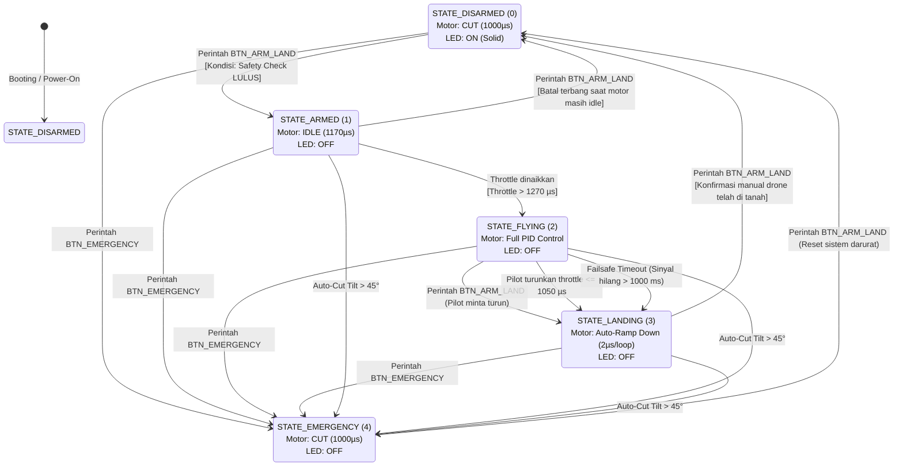
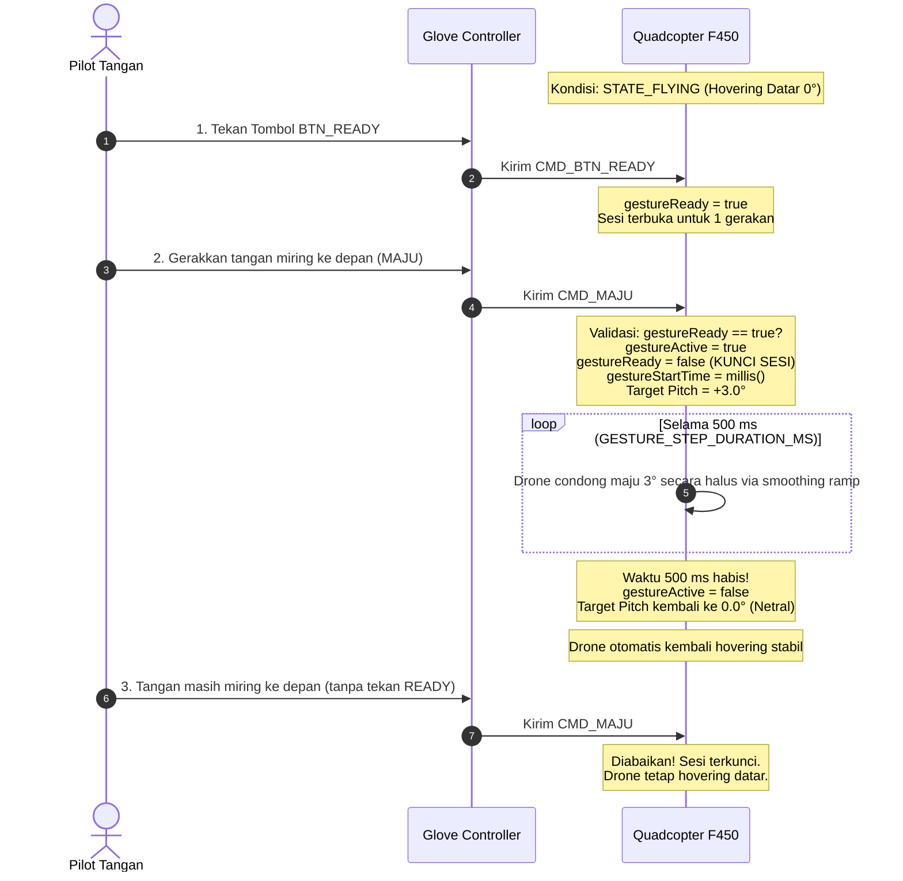
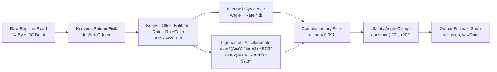
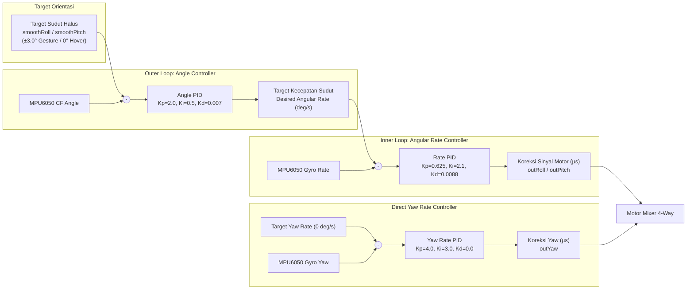
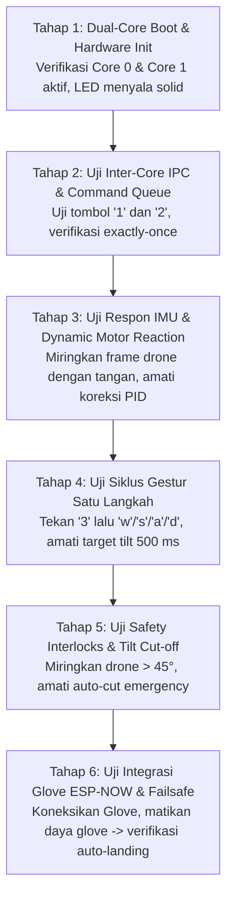

# Arsitektur & Spesifikasi Sistem Quadcopter F450 (Dual-Core FreeRTOS)

> **Dokumen Referensi Teknis Komprehensif**  
> Dokumen ini dirancang sebagai panduan tunggal terlengkap untuk memahami seluruh arsitektur perangkat keras, firmware multitasking dual-core ESP32, sistem estimasi orientasi, kontroler Cascade PID, protokol komunikasi nirkabel ESP-NOW, Finite State Machine, serta protokol keselamatan penerbangan Quadcopter F450 tanpa perlu membaca kode sumber secara manual.

---

## Daftar Isi
1. [Ikhtisar Sistem & Spesifikasi Perangkat Keras](#1-ikhtisar-sistem--spesifikasi-perangkat-keras)
2. [Arsitektur Multitasking Dual-Core FreeRTOS & Sinkronisasi IPC](#2-arsitektur-multitasking-dual-core-freertos--sinkronisasi-ipc)
3. [Pinout Hardware & Skema Rangkaian Elektrik](#3-pinout-hardware--skema-rangkaian-elektrik)
4. [Finite State Machine (FSM) & Prosedur Keselamatan](#4-finite-state-machine-fsm--prosedur-keselamatan)
5. [Glove Controller & Logika Gerakan Satu Langkah (Gesture Step)](#5-glove-controller--logika-gerakan-satu-langkah-gesture-step)
6. [Protokol Komunikasi Data (ESP-NOW & Serial Interface)](#6-protokol-komunikasi-data-esp-now--serial-interface)
7. [Sensor IMU MPU6050 & Estimasi Sikap (Attitude Estimation)](#7-sensor-imu-mpu6050--estimasi-sikap-attitude-estimation)
8. [Skema Kendali Dual-Loop Cascade PID](#8-skema-kendali-dual-loop-cascade-pid)
9. [Motor Mixing & ESC Driver (Quad-X Configuration)](#9-motor-mixing--esc-driver-quad-x-configuration)
10. [Peta Komponen Kode Sumber (Codebase Architecture)](#10-peta-komponen-kode-sumber-codebase-architecture)
11. [Protokol Pengujian Aman (Safe Bench Test Protocol) & Troubleshooting](#11-protokol-pengujian-aman-safe-bench-test-protocol--troubleshooting)

---

## 1. Ikhtisar Sistem & Spesifikasi Perangkat Keras

Quadcopter F450 ini dikendalikan oleh mikrokontroler **ESP32 DevKit V1** (arsitektur dual-core Xtensa LX6 32-bit, clock frekuensi 240 MHz). Drone menerima instruksi penerbangan nirkabel dari controller sarung tangan pintar (**Glove Controller**) berbasis **ESP32-C3** melalui protokol berkecepatan tinggi **ESP-NOW** (2.4 GHz tanpa router WiFi).

### Filosofi Desain Sistem
1. **Asymmetric Multiprocessing (AMP) Decoupling**: Pemisahan tegas antara tugas komunikasi nirkabel/IO pada **Core 0** dan tugas perhitungan kendali penerbangan deterministik pada **Core 1**.
2. **Deterministic Real-Time Control Loop**: Loop kendali terbang berjalan tepat pada **250 Hz (periode 4.000 µs)** tanpa jitter yang disebabkan oleh stack jaringan atau interupsi WiFi.
3. **Fail-Safe by Design**: Failsafe bekerja 100% mandiri pada Core 1. Jika Core 0 mengalami hang atau sinyal glove terputus, drone secara otomatis mengeksekusi *Controlled Landing*.
4. **Step-by-Step Gesture**: Kendali gerakan berbasis gestur menggunakan konsep **1 sesi tombol READY = 1 langkah gerak terukur**, lalu kembali otomatis ke posisi hovering datar untuk menjamin kestabilan.

### Tabel Ringkasan Spesifikasi Teknis
| Komponen / Parameter | Spesifikasi / Nilai Konfigurasi | Keterangan |
|---|---|---|
| **Mikrokontroler Utama** | ESP32-WROOM-32 (DevKit V1) | Dual Core @ 240 MHz, 520 KB SRAM |
| **Sistem Operasi** | FreeRTOS (ESP-IDF v4.x / Arduino Framework) | Multitasking Preemptive Pinned-to-Core |
| **Frekuensi Flight Loop** | **250 Hz** (periode loop 4 ms / 4000 µs) | Dijalankan pada Core 1 (Prioritas 5) |
| **Frekuensi Comm Loop** | **50 Hz** (periode loop 20 ms) | Dijalankan pada Core 0 (Prioritas 2) |
| **Protokol Nirkabel** | ESP-NOW (Unicast/Broadcast 2.4 GHz) | Kanal 1, Latensi transmisi < 3 ms |
| **Sensor IMU** | InvenSense MPU6050 (6-DOF) | I2C Fast-Mode 400 kHz, Pin SDA=21, SCL=22 |
| **Rentang Pengukuran Gyro** | ±500°/s (Sensitivitas: 65.5 LSB/(°/s)) | DLPF Internal Filter: ~44 Hz (Reg 0x1A = 0x03) |
| **Rentang Pengukuran Accel**| ±8g (Sensitivitas: 4096 LSB/g) | Skala register 0x1C = 0x10 |
| **Algoritma Fusi Sensor** | Complementary Filter ($\alpha = 0.991$) | 99.1% integrasi gyro + 0.9% vektor gravitasi accel |
| **Arsitektur Kendali** | Dual-Loop Cascade PID (Angle $\to$ Rate) | Outer Loop: Angle, Inner Loop: Angular Rate |
| **Protokol ESC Motor** | Standard PWM 500 Hz (OneShot compatible) | Rentang pulsa: 1000 µs (Cut) hingga 1999 µs (Full) |
| **Konfigurasi Frame** | Quad-X (Diagonal 450 mm) | FL (CW), FR (CCW), RL (CCW), RR (CW) |

---

## 2. Arsitektur Multitasking Dual-Core FreeRTOS & Sinkronisasi IPC

Mikrokontroler ESP32 memiliki dua core independen: **Core 0 (PRO_CPU)** dan **Core 1 (APP_CPU)**. Arsitektur ini memanfaatkan kedua core secara optimal untuk mengeliminasi konflik latensi antara WiFi stack dan loop kendali terbang.

```mermaid
graph TB
    subgraph Core0 ["CORE 0 (PRO_CPU) — Communication & I/O Engine (50 Hz)"]
        ISR["ESP-NOW ISR Callback<br/>(IRAM_ATTR onDataRecv)<br/>Latency < 5 µs"]
        RawBuf[("Volatile Raw Packet Buffer<br/>_rawPacket")]
        CommTask["commTask (Prioritas 2)<br/>Loop 50 Hz / Period 20 ms"]
        SerialParser["Serial Command Parser<br/>(Bench Testing Interface)"]
        
        ISR -->|Salin Raw Bytes & Set Flag| RawBuf
        RawBuf -->|Ambil & Parse Paket| CommTask
        SerialParser -->|Input Keyboard| CommTask
    end

    subgraph IPC ["Inter-Process Communication (IPC) Primitives"]
        CmdQueue[("xQueueCommand<br/>FreeRTOS Queue (Depth 4)<br/>Data: DroneCommand Enum<br/>Semantics: Exactly-Once")]
        Spinlock[("SharedState (g_sharedState)<br/>portMUX_TYPE g_sharedMux<br/>Data: Throttle, Timestamp, State<br/>Lock Duration < 1 µs")]
    end

    subgraph Core1 ["CORE 1 (APP_CPU) — Real-Time Flight Controller (250 Hz)"]
        FlightTask["flightTask (Prioritas 5 — High Real-Time)<br/>Loop 250 Hz / Period 4.000 µs"]
        Failsafe["Local Safety & Failsafe Watchdog<br/>- Tilt > 45° Check<br/>- Packet Timeout > 1000 ms"]
        FSM["Finite State Machine<br/>(DISARMED / ARMED / FLYING / LANDING / EMERGENCY)"]
        IMUUpdate["MPU6050 Driver (I2C 400 kHz)<br/>Complementary Filter (alpha = 0.991)"]
        PIDBlock["Cascade PID Controller<br/>Angle Loop (20 Hz) -> Rate Loop (250 Hz)"]
        Mixer["Quad-X Motor Mixer & ESC Driver<br/>PWM 500 Hz (FL, FR, RL, RR)"]

        FlightTask --> Failsafe
        Failsafe --> FSM
        FSM --> IMUUpdate
        IMUUpdate --> PIDBlock
        PIDBlock --> Mixer
    end

    CommTask -->|Kirim Perintah Diskrit| CmdQueue
    CommTask -->|Tulis Throttle & Timestamp| Spinlock
    CmdQueue -->|Baca Non-Blocking (cmd)| FlightTask
    Spinlock -->|Atomic Snapshot Read| FlightTask
```

### Rincian Pembagian Tugas Tiap Core

#### 1. Core 0 — Communication Task (`commTask`)
* **Tanggung Jawab**:
  1. Mengelola interupsi radio ESP-NOW (`onDataRecv`).
  2. Memeriksa buffer mentah dari ISR, memvalidasi integritas paket 3-byte biner atau parsing string ASCII fallback.
  3. Menangani perintah Serial Terminal untuk keperluan simulasi uji meja (*bench testing*).
  4. Menulis data throttle dan memperbarui waktu paket masuk (`lastPacketTime`) ke memori bersama yang dilindungi spinlock.
  5. Mendorong perintah aksi diskrit (tombol & gesture) ke dalam antrean FreeRTOS Queue.
* **Karakteristik Operasional**:
  - Prioritas: **2** (Cukup rendah, sehingga yield ke background stack sistem ESP32 WiFi bila diperlukan).
  - Waktu Tidur: `vTaskDelayUntil(&xLastWakeTime, pdMS_TO_TICKS(20))` (50 Hz).
  - Stack Size: **4096 bytes**.

#### 2. Core 1 — Flight Control Task (`flightTask`)
* **Tanggung Jawab**:
  1. Menjaga ketepatan loop waktu eksekusi tepat **4000 µs (250 Hz)** via kombinasi `vTaskDelay(1)` dan *microsecond spin-wait*.
  2. Menarik perintah diskrit dari `xQueueCommand` secara non-blocking (`ticksToWait = 0`).
  3. Mengambil salinan snapshot atomik dari `g_sharedState` via critical section spinlock (< 1 µs).
  4. Menjalankan logika lokal **Failsafe Watchdog**: mendeteksi hilangnya paket dari Core 0 atau kemiringan drone abnormal.
  5. Menjalankan **Finite State Machine (FSM)**.
  6. Mengakuisisi data 14 byte dari sensor MPU6050 via I2C 400 kHz dan menghitung Complementary Filter.
  7. Menerapkan penghalusan ramp target sudut gerakan (*Smoothing Ramp*).
  8. Menghitung dua tahap kendali **Cascade PID** (Angle Roll/Pitch $\to$ Rate Roll/Pitch $\to$ Direct Rate Yaw).
  9. Melakukan mixing motor Quad-X dan memperbarui sinyal PWM hardware timer ke 4 ESC.
  10. Mengirimkan telemetri status ke Serial pada frekuensi 20 Hz.
* **Karakteristik Operasional**:
  - Prioritas: **5** (Tinggi, eksekusi real-time terjamin, tidak terganggu oleh garbage collection atau komputasi non-real-time).
  - Stack Size: **4096 bytes**.

### Mekanisme Inter-Process Communication (IPC)

| Saluran Data | Primitif FreeRTOS | Tipe Data | Alasan Teknis & Sifat |
|---|---|---|---|
| **Event / Perintah Diskrit** | `xQueueCommand` | `DroneCommand` (Enum 1 byte) | **Semantik Exactly-Once**: Event penekanan tombol (ARM, EMERGENCY, READY, Gesture) tidak boleh hilang, tidak boleh tertumpuk, dan dieksekusi tepat satu kali. Kedalaman antrean = 4. |
| **Data Kontinu (Throttle & Time)** | `g_sharedState` + `g_sharedMux` | `SharedState` Struct | **Zero-Latency Copy (< 1 µs)**: Menggunakan `portENTER_CRITICAL` / `portEXIT_CRITICAL`. Menghindari resiko Priority Inversion yang biasa terjadi jika menggunakan FreeRTOS Mutex. |
| **ISR WiFi ke CommTask** | `_rawPacket` + `_hasNewRawPacket` | `RawPacket` Struct + `bool` | **Minimal ISR Execution (< 5 µs)**: Callback ISR tidak pernah melakukan parsing atau mencetak log. Hanya `memcpy` data mentah dan set flag `true`. |

---

## 3. Pinout Hardware & Skema Rangkaian Elektrik

### Pemetaan Pin GPIO ESP32 DevKit V1

```
                         ESP32 DEVKIT V1 (30 PIN)
                              +------------+
                              |    USB     |
                              | [ESP-WROOM]|
                       EN ----|            |---- GPIO 23
                  GPIO 36 ----|            |---- GPIO 22 (I2C SCL -> MPU6050)
                  GPIO 39 ----|            |---- GPIO 1  (TX0)
                  GPIO 34 ----|            |---- GPIO 3  (RX0)
                  GPIO 35 ----|            |---- GPIO 21 (I2C SDA -> MPU6050)
                  GPIO 32 ----|            |---- GPIO 19
  (Rear-Right)    GPIO 33 ----|            |---- GPIO 18
  (Front-Right)   GPIO 25 ----|            |---- GPIO 5
  (Front-Left)    GPIO 27 ----|            |---- GPIO 17
                  GPIO 14 ----|            |---- GPIO 16
  (Rear-Left)     GPIO 12 ----|            |---- GPIO 4
                  GPIO 13 ----|            |---- GPIO 0
                      GND ----|            |---- GPIO 2
                      VIN ----|            |---- GPIO 15 (LED Indikator)
                              +------------+
```

### Tabel Rincian Koneksi Pinout
| Komponen | Pin ESP32 | Mode Pin | Fungsi / Sinyal | Keterangan Elektrikal |
|---|---|---|---|---|
| **Motor 4 (Front-Left)** | **GPIO 27** | Output (LEDC) | PWM Sinyal ESC (FL) | Putaran CW, Periode 500 Hz |
| **Motor 1 (Front-Right)**| **GPIO 25** | Output (LEDC) | PWM Sinyal ESC (FR) | Putaran CCW, Periode 500 Hz |
| **Motor 3 (Rear-Left)**  | **GPIO 12** | Output (LEDC) | PWM Sinyal ESC (RL) | Putaran CCW, Periode 500 Hz |
| **Motor 2 (Rear-Right)** | **GPIO 33** | Output (LEDC) | PWM Sinyal ESC (RR) | Putaran CW, Periode 500 Hz |
| **MPU6050 SDA**         | **GPIO 21** | I2C Data | Jalur Komunikasi I2C | Memerlukan pull-up resistor 4.7kΩ ke 3.3V |
| **MPU6050 SCL**         | **GPIO 22** | I2C Clock | Jalur Sinyal Clock I2C | Kecepatan bus: 400.000 Hz (Fast Mode) |
| **Status LED**          | **GPIO 15** | Output GPIO | Indikator Status Drone | Active-HIGH (ON saat DISARMED, OFF saat terbang) |

---

## 4. Finite State Machine (FSM) & Prosedur Keselamatan

Flight controller dioperasikan melalui **State Machine Deterministik** 5 status. Transisi antar status diatur secara ketat untuk mencegah motor berputar secara tidak sengaja atau mati mendadak saat drone berada di udara.

### Diagram Transisi State Lengkap



### Penjelasan Detail Tiap Status (Drone State)

#### 1. `STATE_DISARMED` (Nilai Enum: 0)
* **Kondisi Motor**: Pulsa PWM dipaksa ke **1000 µs** (`motor.cut()`). Motor mati total.
* **Indikator LED**: Menyala solid (`digitalWrite(LED_PIN, HIGH)`). Menandakan sistem dalam kondisi aman untuk dipegang.
* **Aksi Pilot**: Pilot dapat menekan tombol kalibrasi `'c'` pada serial atau menekan tombol `BTN_ARM_LAND` untuk mempersiapkan terbang.
* **Syarat Transisi ke ARMED**: Harus melewati **3 lapis Safety Check**:
  1. Orientasi permukaan drone harus datar: $|\text{Roll}| < 30^\circ$ dan $|\text{Pitch}| < 30^\circ$, serta data sensor bukan NaN.
  2. Remote glove harus terhubung aktif (`(millis() - lastPacketTime) < 1000 ms`).
  3. Throttle harus berada di batas minimum ($\le 1220 \text{ µs}$).

#### 2. `STATE_ARMED` (Nilai Enum: 1)
* **Kondisi Motor**: Motor mulai berputar perlahan pada batas minimum **Idle Floor (1170 µs)**.
* **Indikator LED**: Padam.
* **Aksi Pilot**: Memberikan peringatan visual bahwa baling-baling telah berputar. Jika pilot menaikkan throttle melebihi ambang batas lift-off (`PWM_IDLE + 100 = 1270 µs`), sistem langsung berpindah ke `STATE_FLYING`.
* **Pembatalan**: Jika pilot berubah pikiran sebelum menaikkan throttle, tekan kembali `BTN_ARM_LAND` untuk kembali ke `STATE_DISARMED`.

#### 3. `STATE_FLYING` (Nilai Enum: 2)
* **Kondisi Motor**: Beroperasi penuh dengan kalkulasi **Cascade PID** dan kontrol throttle dinamis dari remote (rentang 1170 s.d. 1800 µs).
* **Fungsi Khusus**: Mode penerimaan gestur satu langkah aktif melalui penekanan tombol `BTN_READY`.
* **Proteksi Otomatis**: Jika throttle diturunkan hingga $\le 1050 \text{ µs}$, drone otomatis memasuki mode `STATE_LANDING` untuk mencegah drone jatuh bebas (*free-fall*).

#### 4. `STATE_LANDING` (Nilai Enum: 3)
* **Kondisi Motor**: Throttle diturunkan secara bertahap dan teratur dengan laju **2 µs per loop** (setara penurunan ~500 µs per detik pada 250 Hz loop) hingga mencapai batas dasar landing **1050 µs**.
* **Koreksi Sikap**: Target orientasi sudut dikunci pada posisi datar ideal ($\text{Target Pitch} = 0^\circ, \text{Target Roll} = 0^\circ$) dengan PID tetap aktif menjaga kestabilan drone saat turun.
* **PENTING — Konfirmasi Manual**: Karena sistem F450 ini tidak dilengkapi sensor jarak ultrasonik atau barometer, **sistem tidak pernah mematikan motor secara otomatis saat landing**. Pilot harus menekan tombol `BTN_ARM_LAND` setelah melihat fisik drone telah menyentuh tanah untuk mengunci motor ke `STATE_DISARMED`.

#### 5. `STATE_EMERGENCY` (Nilai Enum: 4)
* **Kondisi Motor**: Semua sinyal pulsa ESC dipotong seketika ke **1000 µs** tanpa delay.
* **Pemicu**: 
  - Penekanan tombol kill-switch `BTN_EMERGENCY` pada glove atau serial terminal (dapat diakses dari state manapun).
  - Pemicu otomatis dari *Local Tilt Protection* jika drone terbalik atau miring ekstrim ($|\text{Roll}| > 45^\circ$ atau $|\text{Pitch}| > 45^\circ$).
* **Pemulihan**: Drone hanya dapat keluar dari status bahaya ini jika pilot menekan tombol `BTN_ARM_LAND`, yang akan mereset status kembali ke `STATE_DISARMED`.

---

## 5. Glove Controller & Logika Gerakan Satu Langkah (Gesture Step)

Sistem remote pengendali berbentuk sarung tangan pintar (*smart glove*) yang dilengkapi 3 tombol mekanik dan sensor IMU pada punggung tangan untuk mendeteksi kemiringan gestur.

```
+-------------------------------------------------------------------------+
|                        SMART GLOVE CONTROLLER                           |
|                                                                         |
|      [TOMBOL 1: BTN_ARM_LAND]            [TOMBOL 2: BTN_EMERGENCY]      |
|    (Tombol Kontekstual Multi-State)         (Kill-Switch Seketika)      |
|                                                                         |
|      [TOMBOL 3: BTN_READY]               [IMU GESTURE SENSOR]           |
|    (Pemicu Sesi 1 Gerakan Gestur)           (Deteksi Kemiringan Tangan) |
+-------------------------------------------------------------------------+
```

### Tabel Perilaku Tombol Kontekstual (`BTN_ARM_LAND`)
Fungsi tombol ini menyesuaikan status drone secara otomatis:

| Status Drone Saat Tombol Ditekan | Fungsi Tombol | Hasil Status Baru | Catatan Perilaku |
|---|---|---|---|
| `DISARMED` | **ARM** | `ARMED` | Menjalankan safety check (sudut datar, throttle low, sinyal aktif). |
| `ARMED` | **DISARM** | `DISARMED` | Mematikan kembali motor sebelum pesawat sempat terbang. |
| `FLYING` | **LAND** | `LANDING` | Mengaktifkan penurunan throttle bertahap yang terkendali. |
| `LANDING` | **CONFIRM** | `DISARMED` | Konfirmasi visual pilot bahwa drone telah menyentuh tanah. |
| `EMERGENCY` | **RESET** | `DISARMED` | Memulihkan sistem ke status aman setelah insiden darurat. |

### Logika Eksekusi Gestur Satu Langkah (One-Step Gesture Engine)

Untuk mencegah resiko kehilangan kendali akibat tangan pilot gemetar atau terus miring tanpa disengaja, arsitektur ini menerapkan sistem penguncian **Single-Step Execution**:



### Parameter Gestur Gerak
* **Besar Kemiringan Target (`GESTURE_TILT_ANGLE`)**: **$\pm 3.0^\circ$** (sudut aman yang menghasilkan translasi linear halus tanpa kehilangan daya angkat vertikal drastis).
* **Durasi Langkah (`GESTURE_STEP_DURATION_MS`)**: **$500\text{ ms}$** (0.5 detik).
* **Smoothing Ramp Rate (`TILT_RAMP_RATE`)**: **$0.08$ per loop**. Target sudut dihaluskan dengan rumus:
  $$\text{SmoothAngle}_k = \text{SmoothAngle}_{k-1} + (\text{TargetAngle} - \text{SmoothAngle}_{k-1}) \times 0.08$$

---

## 6. Protokol Komunikasi Data (ESP-NOW & Serial Interface)

### 1. Struktur Paket Biner ESP-NOW (Ukuran: 3 Bytes)
Untuk meminimalkan waktu transmisi radio (< 1 ms), pertukaran data menggunakan representasi biner terpadat:

```cpp
struct __attribute__((packed)) DronePacket
{
    uint8_t  command;   // 1 byte: Nilai dari DroneCommand enum
    uint16_t throttle;  // 2 byte: Nilai throttle (1000 - 1800 µs, Little-Endian)
};
```

#### Pemetaan Nilai Enum Command (`DroneCommand`):
| Nilai Desimal | Identitas Enum | Arti Perintah |
|---|---|---|
| `0` | `CMD_NONE` | Heartbeat / Idle (hanya memperbarui throttle & waktu timeout) |
| `1` | `CMD_MAJU` | Gestur condong ke depan (+3° Pitch) |
| `2` | `CMD_MUNDUR` | Gestur condong ke belakang (-3° Pitch) |
| `3` | `CMD_KIRI` | Gestur condong ke kiri (-3° Roll) |
| `4` | `CMD_KANAN` | Gestur condong ke kanan (+3° Roll) |
| `10` | `CMD_BTN_ARM_LAND` | Tombol 1: ARM / LAND / CONFIRM / RESET |
| `11` | `CMD_BTN_EMERGENCY`| Tombol 2: Emergency Motor Cut |
| `12` | `CMD_BTN_READY` | Tombol 3: Buka kunci satu sesi gestur |
| `20` | `CMD_THROTTLE_UP` | Serial Debug: Naikkan throttle +25 µs |
| `21` | `CMD_THROTTLE_DN` | Serial Debug: Turunkan throttle -25 µs |
| `22` | `CMD_CALIBRATE` | Serial Debug: Trigger kalibrasi sensor IMU |
| `23` | `CMD_STATUS` | Serial Debug: Cetak info telemetri lengkap |

### 2. Format Teks String Fallback
Driver juga mengenali string ASCII untuk pengujian melalui terminal serial atau transmitter sederhana:
* `"ARM_LAND"` atau `"T1"` $\to$ `CMD_BTN_ARM_LAND`
* `"EMERGENCY"`, `"T2"`, atau `"E"` $\to$ `CMD_BTN_EMERGENCY`
* `"READY"` atau `"T3"` $\to$ `CMD_BTN_READY`
* `"MAJU"` / `"F"`, `"MUNDUR"` / `"B"`, `"KIRI"` / `"L"`, `"KANAN"` / `"R"` $\to$ Gestur gerak

---

## 7. Sensor IMU MPU6050 & Estimasi Sikap (Attitude Estimation)

Sistem menggunakan IMU 6-Axis **InvenSense MPU6050** yang berkomunikasi pada bus I2C hardware (SDA=GPIO21, SCL=GPIO22) pada clock speed 400 kHz.

### Konfigurasi Register Internal Sensor
1. **Power Management 1 (`0x6B`) $\to$ `0x00`**: Membangunkan MPU6050 dari sleep mode dan menyinkronkan clock ke osilator internal gyro.
2. **DLPF Digital Low-Pass Filter (`0x1A`) $\to$ `0x03`**: Mengatur filter perangkat keras onboard pada bandwidth frekuensi ~44 Hz dengan delay 4.9 ms untuk meredam noise getaran mekanis motor BLDC.
3. **Gyro Configuration (`0x1B`) $\to$ `0x08`**: Full-scale $\pm 500^\circ/\text{s}$ (Sensitivitas = 65.5 LSB/(°/s)).
4. **Accel Configuration (`0x1C`) $\to$ `0x10`**: Full-scale $\pm 8\text{g}$ (Sensitivitas = 4096 LSB/g).

### Alur Matematis Estimasi Sudut



#### 1. Konversi Nilai Mentah ke Satuan Fisik:
$$\text{RateRoll}_{\text{raw}} = \frac{\text{gx}}{65.5}, \quad \text{RatePitch}_{\text{raw}} = \frac{\text{gy}}{65.5}, \quad \text{RateYaw}_{\text{raw}} = \frac{\text{gz}}{65.5}$$
$$\text{AccX}_{\text{raw}} = \frac{\text{ax}}{4096.0}, \quad \text{AccY}_{\text{raw}} = \frac{\text{ay}}{4096.0}, \quad \text{AccZ}_{\text{raw}} = \frac{\text{az}}{4096.0}$$

#### 2. Koreksi Kalibrasi:
Nilai offset fisik yang ditentukan saat kalibrasi 2000 sampel pada posisi datar:
$$\text{rollRate} = \text{RateRoll}_{\text{raw}} - (-2.40), \quad \text{pitchRate} = \text{RatePitch}_{\text{raw}} - (-2.09), \quad \text{yawRate} = \text{RateYaw}_{\text{raw}} - 0.83$$
$$\text{accX} = \text{AccX}_{\text{raw}} - 0.08, \quad \text{accY} = \text{AccY}_{\text{raw}} - (-0.01), \quad \text{accZ} = \text{AccZ}_{\text{raw}} - 0.02$$

#### 3. Estimasi Sudut Berbasis Vektor Akselerometer:
$$\text{AngleRoll}_{\text{acc}} = \arctan\left(\frac{\text{accY}}{\sqrt{\text{accX}^2 + \text{accZ}^2}}\right) \times \frac{180}{\pi}$$
$$\text{AnglePitch}_{\text{acc}} = -\arctan\left(\frac{\text{accX}}{\sqrt{\text{accY}^2 + \text{accZ}^2}}\right) \times \frac{180}{\pi}$$

#### 4. Fusi Sensor Complementary Filter ($\alpha = 0.991$):
Filter komplementer menggabungkan kestabilan jangka pendek gyro (bebas gangguan getaran motor) dengan kestabilan jangka panjang akselerometer (bebas drift integrasi):
$$\text{Roll}_k = 0.991 \times (\text{Roll}_{k-1} + \text{rollRate} \cdot \Delta t) + 0.009 \times \text{AngleRoll}_{\text{acc}}$$
$$\text{Pitch}_k = 0.991 \times (\text{Pitch}_{k-1} + \text{pitchRate} \cdot \Delta t) + 0.009 \times \text{AnglePitch}_{\text{acc}}$$

---

## 8. Skema Kendali Dual-Loop Cascade PID

Arsitektur kendali quadcopter menggunakan sistem **Cascade PID (Dual-Loop)**. Desain dua loop ini mutlak diperlukan karena kontroler sudut (*Angle Loop*) saja terlalu lambat untuk meredam inersia quadcopter. Loop kecepatan sudut (*Rate Loop*) di dalamnya bertindak sebagai peredam dinamis (*damping*) berkecepatan tinggi.



### Formulasi Algoritma PID (Metode Integrasi Trapesium)
Untuk menjaga keakuratan integral pada loop diskrit, perhitungan akumulator integral menggunakan kaidah trapesium (*trapezoidal rule*):

$$P_{\text{term}} = K_p \cdot e_k$$
$$I_{\text{term}} = I_{k-1} + K_i \cdot \frac{e_k + e_{k-1}}{2} \cdot \Delta t \quad \text{dengan clamping: } [-400, +400]$$
$$D_{\text{term}} = K_d \cdot \frac{e_k - e_{k-1}}{\Delta t}$$
$$\text{Output} = \text{constrain}(P_{\text{term}} + I_{\text{term}} + D_{\text{term}}, -400, +400)$$

### Tabel Gain PID & Batas Saturasi
| Loop | Sumbu | Kp | Ki | Kd | Saturasi Output | Keterangan Fungsi |
|---|---|---|---|---|---|---|
| **Outer (Angle)** | Roll | 2.0 | 0.5 | 0.007 | ±400 deg/s | Mengubah deviasi sudut derajat menjadi target kecepatan putar |
| **Outer (Angle)** | Pitch | 2.0 | 0.5 | 0.007 | ±400 deg/s | Simetris dengan sumbu Roll |
| **Inner (Rate)**  | Roll | 0.625 | 2.1 | 0.0088 | ±400 µs | Mengubah selisih laju putar menjadi penyesuaian pulsa PWM motor |
| **Inner (Rate)**  | Pitch | 0.625 | 2.1 | 0.0088 | ±400 µs | Simetris dengan sumbu Roll |
| **Direct Rate**   | Yaw | 4.0 | 3.0 | 0.0 | ±400 µs | Menahan perputaran arah hadap (heading hold) tanpa outer angle loop |

---

## 9. Motor Mixing & ESC Driver (Quad-X Configuration)

Sistem menggunakan konfigurasi standar **Quad-X** di mana 4 motor tersusun membentuk sudut 90 derajat dengan arah putaran saling berlawanan untuk mengompensasi torsi reaktif baling-baling.

### Geometri Tata Letak Motor & Arah Putaran
```
           DEPAN (FRONT)
                 ^
    M4 (FL)      |      M1 (FR)
     [CW]        |       [CCW]
     (Pin 27)    |       (Pin 25)
           \     |     /
            \    |    /
             \---+---/
              | ESP |
             /---+---\
            /    |    \
           /     |     \
     [CCW]       |       [CW]
    M3 (RL)      |      M2 (RR)
     (Pin 12)    |       (Pin 33)
                 |
          BELAKANG (REAR)
```

### Persamaan Matriks Mixer Quad-X
Setiap motor menerima kombinasi linear dari input Throttle dasar dan koreksi dari controller PID untuk ketiga sumbu:

$$\begin{bmatrix} M_{\text{FR}} \\ M_{\text{RR}} \\ M_{\text{RL}} \\ M_{\text{FL}} \end{bmatrix} = \begin{bmatrix} 1 & -1 & -1 & -1 \\ 1 & -1 & +1 & +1 \\ 1 & +1 & +1 & -1 \\ 1 & +1 & -1 & +1 \end{bmatrix} \begin{bmatrix} \text{Throttle} \\ \text{Roll}_{\text{out}} \\ \text{Pitch}_{\text{out}} \\ \text{Yaw}_{\text{out}} \end{bmatrix}$$

Atau dalam bentuk persamaan individual:
* **M1 (FR - Front-Right / CCW / GPIO 25)**:  
  $$\text{PWM}_{\text{FR}} = \text{Throttle} - \text{Roll}_{\text{out}} - \text{Pitch}_{\text{out}} - \text{Yaw}_{\text{out}}$$
* **M2 (RR - Rear-Right / CW / GPIO 33)**:  
  $$\text{PWM}_{\text{RR}} = \text{Throttle} - \text{Roll}_{\text{out}} + \text{Pitch}_{\text{out}} + \text{Yaw}_{\text{out}}$$
* **M3 (RL - Rear-Left / CCW / GPIO 12)**:  
  $$\text{PWM}_{\text{RL}} = \text{Throttle} + \text{Roll}_{\text{out}} + \text{Pitch}_{\text{out}} - \text{Yaw}_{\text{out}}$$
* **M4 (FL - Front-Left / CW / GPIO 27)**:  
  $$\text{PWM}_{\text{FL}} = \text{Throttle} + \text{Roll}_{\text{out}} - \text{Pitch}_{\text{out}} + \text{Yaw}_{\text{out}}$$

### Pengamanan Sinyal PWM (Clamping & Floor)
1. **Idle Floor (1170 µs)**: Saat status `ARMED`, `FLYING`, atau `LANDING`, pulsa setiap motor dibatasi minimum ke `PWM_IDLE` (1170 µs) menggunakan fungsi `constrain(pwm, PWM_IDLE, PWM_MAX)`. Hal ini mencegah motor mati mendadak di udara saat koreksi PID bernilai negatif besar.
2. **Emergency Cut-off (1000 µs)**: Jika throttle berada di bawah ambang batas (`THROTTLE_CUTOFF = 1030 µs`), atau sistem dalam status `DISARMED`/`EMERGENCY`, seluruh output motor langsung dipaksa ke `PWM_ARM = 1000 µs`.
3. **Upper Limit (1999 µs)**: Melindungi ESC dari pulsa di luar batas kendali maksimum standar.

---

## 10. Peta Komponen Kode Sumber (Codebase Architecture)

Proyek ini telah direfaktor menjadi arsitektur modular yang bersih tanpa ketergantungan melingkar (*circular dependencies*):

```
QuadcopterF450/
├── platformio.ini              # Konfigurasi PlatformIO build & lib_deps
├── arsitektur.md               # Dokumen Arsitektur Sistem Utama (File Ini)
├── include/
│   ├── config.h                # Master konstanta, pinout, PID gain, timing loop
│   ├── shared/
│   │   └── shared_types.h      # Enum status, struct paket, objek sinkronisasi FreeRTOS
│   ├── comm/
│   │   └── comm_task.h         # Deklarasi tugas Core 0 (commTask)
│   ├── flight/
│   │   └── flight_task.h       # Deklarasi tugas Core 1 (flightTask)
│   ├── imu/
│   │   └── imu.h               # Antarmuka driver MPU6050 & Complementary Filter
│   ├── pid/
│   │   └── pid.h               # Antarmuka kelas CascadeController & PID
│   ├── motor/
│   │   └── motor.h             # Antarmuka driver ESC & Quad-X Mixer
│   └── ReceiverEspNow/
│       └── ReceiverEspNow.h    # Antarmuka driver penerima radio ESP-NOW
└── src/
    ├── main.cpp                # Setup hardware, inisialisasi IPC, spawn task FreeRTOS
    ├── comm/
    │   └── comm_task.cpp       # Implementasi task Core 0: ESP-NOW buffer & Serial test
    ├── flight/
    │   └── flight_task.cpp     # Implementasi task Core 1: 250Hz Loop, FSM, Safety, PID
    ├── imu/
    │   └── imu.cpp             # Implementasi MPU6050: I2C burst read, kalibrasi fisik
    ├── pid/
    │   └── pid.cpp             # Implementasi perhitungan matematis Cascade PID
    ├── motor/
    │   └── motor.cpp           # Implementasi PWM Hardware ESP32 & Quad-X mixing
    └── ReceiverEspNow/
        └── ReceiverEspNow.cpp  # Implementasi ISR callback minimal & parser paket
```

### Tabel Rincian Modul & Tanggung Jawab

| Modul File | Eksekusi | Tanggung Jawab & Logika Internal |
|---|---|---|
| [`include/config.h`](file:///c:/Users/asus/Documents/PlatformIO/Projects/QuadcopterF450/include/config.h) | Global | Pusat definisi angka magis: pin GPIO motor & I2C, konstanta skala MPU6050, gain PID, durasi gesture (500ms), frekuensi loop (250Hz & 50Hz). |
| [`include/shared/shared_types.h`](file:///c:/Users/asus/Documents/PlatformIO/Projects/QuadcopterF450/include/shared/shared_types.h) | Inter-Core | Definisi `DroneState`, `DroneCommand`, struktur paket `DronePacket` (3 bytes), `SharedState`, dan deklarasi global `xQueueCommand` & `g_sharedMux`. |
| [`src/main.cpp`](file:///c:/Users/asus/Documents/PlatformIO/Projects/QuadcopterF450/src/main.cpp) | Boot Init | Menjalankan inisialisasi awal serial 115200, motor attach, inisialisasi I2C MPU6050 (fatal halt jika gagal), registrasi ESP-NOW, pembuatan Queue, dan pinning task ke Core 0 & Core 1. |
| [`src/comm/comm_task.cpp`](file:///c:/Users/asus/Documents/PlatformIO/Projects/QuadcopterF450/src/comm/comm_task.cpp) | **Core 0** (50 Hz) | Membaca raw packet buffer dari ISR, memvalidasi paket biner, memperbarui timestamp paket dengan spinlock atomik, mengirim command ke queue, serta membaca input keyboard serial. |
| [`src/flight/flight_task.cpp`](file:///c:/Users/asus/Documents/PlatformIO/Projects/QuadcopterF450/src/flight/flight_task.cpp) | **Core 1** (250 Hz) | Jantung pengendali: loop waktu presisi 4000µs, penerimaan queue non-blocking, snapshot spinlock, pemrosesan FSM, eksekusi gesture step, kalkulasi IMU + PID, dan output ke motor. |
| [`src/imu/imu.cpp`](file:///c:/Users/asus/Documents/PlatformIO/Projects/QuadcopterF450/src/imu/imu.cpp) | **Core 1** | Konfigurasi register MPU6050 via Wire I2C 400kHz, sampling offset 2000 titik, konversi satuan fisik, estimasi sudut percepatan, dan integrasi Complementary Filter. |
| [`src/pid/pid.cpp`](file:///c:/Users/asus/Documents/PlatformIO/Projects/QuadcopterF450/src/pid/pid.cpp) | **Core 1** | Algoritma komputasi PID trapesium dengan anti-windup clamping. Mengatur outer loop (Roll/Pitch) dan inner loop (Roll/Pitch/Yaw). |
| [`src/motor/motor.cpp`](file:///c:/Users/asus/Documents/PlatformIO/Projects/QuadcopterF450/src/motor/motor.cpp) | **Core 1** | Mengendalikan modul ESP32PWM timer 500Hz pada GPIO 25, 33, 12, 27. Menghitung formula distribusi Quad-X mixing dan menjaga batas aman motor idle floor. |
| [`src/ReceiverEspNow/ReceiverEspNow.cpp`](file:///c:/Users/asus/Documents/PlatformIO/Projects/QuadcopterF450/src/ReceiverEspNow/ReceiverEspNow.cpp) | **Core 0** (ISR) | Mendaftarkan callback radio ESP-NOW `onDataRecv` yang hanya melakukan copy memori secepat kilat (< 5µs) ke struct `_rawPacket`. |

---

## 11. Protokol Pengujian Aman (Safe Bench Test Protocol) & Troubleshooting

> [!CAUTION]
> **ATURAN MUTLAK KESELAMATAN: JANGAN PERNAH MEMASANG BALING-BALING (*PROPELLERS*) SAAT UJI COBA BENCH TEST DI MEJA KERJA.**  
> Seluruh pengujian software, komunikasi, dan respon PID harus dilakukan dengan kondisi motor polos tanpa bilah baling-baling. Motor brushless F450 memiliki torsi yang cukup kuat untuk melukai tubuh jika berputar tanpa kendali.

### Antarmuka Pengujian Meja (Serial Command Interface)
Buka Serial Monitor pada kecepatan **115200 Baud**. Gunakan tombol keyboard berikut untuk memverifikasi logika drone:

| Tombol Keyboard | Perintah Terkirim | Hasil / Respon Sistem yang Diharapkan |
|---|---|---|
| `1` | `CMD_BTN_ARM_LAND` | Tombol multi-state: DISARMED $\to$ ARMED $\to$ LANDING $\to$ CONFIRM DISARMED. |
| `2` | `CMD_BTN_EMERGENCY` | Memotong putaran motor seketika menjadi 1000 µs dari status apapun. |
| `3` | `CMD_BTN_READY` | Membuka sesi gestur satu langkah saat dalam status `FLYING`. |
| `w` / `s` | `CMD_MAJU` / `CMD_MUNDUR` | Target Pitch condong $\pm 3.0^\circ$ selama 500 ms lalu kembali netral (0°). |
| `a` / `d` | `CMD_KIRI` / `CMD_KANAN` | Target Roll condong $\pm 3.0^\circ$ selama 500 ms lalu kembali netral (0°). |
| `+` | `CMD_THROTTLE_UP` | Menaikkan throttle sebesar +25 µs (maksimum 1800 µs). |
| `-` | `CMD_THROTTLE_DN` | Menurunkan throttle sebesar -25 µs (minimum 1170 µs). |
| `c` | `CMD_CALIBRATE` | Menjalankan pengukuran offset IMU 2000 sampel (hanya aktif saat `DISARMED`). |
| `?` | `CMD_STATUS` | Mencetak status drone, nilai throttle, sudut IMU, dan status koneksi saat ini. |

---

### Tahapan Pengujian Mandiri (Step-by-Step Validation)



#### Tahap 1: Verifikasi Booting & Dual-Core Task Allocation
1. Sambungkan ESP32 ke PC dan buka Serial Monitor (115200 baud).
2. Tekan tombol EN/RST pada ESP32.
3. **Hasil yang Diharapkan**:
   - Log mencetak: `[FLIGHT TASK] Berjalan pada Core 1 (Prioritas 5)`.
   - Log mencetak: `[COMM TASK] Berjalan pada Core 0 (Prioritas 2)`.
   - Sensor MPU6050 terdeteksi pada alamat `0x68` atau `0x69`.
   - LED GPIO 15 menyala solid (menandakan drone berada di status `SAFE DISARMED`).
   - Keempat motor diam total (pulsa 1000 µs).

#### Tahap 2: Verifikasi Antrean Perintah IPC (Inter-Core)
1. Kirim karakter `'?'` pada Serial Monitor. Status harus menunjukkan `DISARMED`.
2. Kirim karakter `'1'`. Karena belum ada remote glove terhubung, sistem harus menolak dengan log: `[SAFETY] GAGAL: Controller nirkabel belum terhubung!`.
3. Simulasikan pengujian atau hubungkan remote glove, lalu tekan `'1'` $\to$ Drone berpindah ke `ARMED` (LED padam, motor berputar idle 1170 µs).
4. Tekan `'2'` $\to$ Sistem seketika masuk ke `EMERGENCY` (motor mati 1000 µs).
5. Tekan `'1'` $\to$ Sistem ter-reset kembali ke `DISARMED`.

#### Tahap 3: Uji Respons Koreksi PID Dinamis
1. Posisikan drone dalam status `ARMED`.
2. Tekan tombol `'+'` beberapa kali hingga throttle melampaui 1270 µs $\to$ Status berubah menjadi `FLYING`.
3. Angkat rangka quadcopter dengan tangan dan miringkan ke kanan:
   - Motor sisi kanan (FR dan RR) harus otomatis menaikkan putaran untuk melawan kemiringan.
   - Motor sisi kiri (FL dan RL) harus otomatis menurunkan putaran.
4. Miringkan rangka quadcopter ke depan:
   - Motor depan (FL dan FR) menaikkan putaran, motor belakang menurunkan putaran.
5. Ini membuktikan bahwa pembacaan sensor dan polaritas Cascade PID sudah benar dan tidak terbalik.

#### Tahap 4: Uji Durasi Gestur Satu Langkah
1. Saat berada di status `FLYING`, tekan tombol `'3'` (`BTN_READY`).
   - Log menampilkan: `[GESTURE] Sesi READY aktif!`.
2. Segera tekan tombol `'w'` (`MAJU`).
   - Log menampilkan: `[GESTURE] Dieksekusi: Kemiringan 3.0° selama 500ms`.
   - Nilai `Tgt(P:+3.0)` muncul di log telemetri.
3. Amati setelah 500 milidetik:
   - Log menampilkan: `[GESTURE] Selesai. Target orientasi kembali netral.`.
   - Nilai `Tgt` kembali ke `+0.0`.
4. Coba tekan kembali tombol `'w'` tanpa menekan tombol `'3'` terlebih dahulu $\to$ Perintah harus diabaikan secara otomatis.

#### Tahap 5: Uji Proteksi Kemiringan Ekstrim (> 45°)
1. Dalam status `FLYING` atau `ARMED`, miringkan drone lebih dari $45^\circ$ dengan tangan secara cepat.
2. **Hasil yang Diharapkan**:
   - Sistem seketika mendeteksi pelanggaran batas sudut dan mencetak:  
     `[SAFETY] Sudut melebihi 45° atau sensor invalid! Emergency auto-cut!`.
   - Status drone berpindah seketika ke `EMERGENCY` dan keempat motor langsung dimatikan.

#### Tahap 6: Uji Failsafe Hilang Sinyal (Loss of Signal)
1. Terbangkan drone secara simulasi dengan glove terhubung aktif (`FLYING`).
2. Matikan power switch pada Glove Controller ESP32-C3.
3. Perhatikan stopwatch: tepat pada $1000\text{ ms}$ setelah paket terakhir berhenti:
   - Core 1 mendeteksi timeout lokal dan mencetak:  
     `[FAILSAFE] Sinyal controller terputus! Mengaktifkan controlled landing...`.
   - Status berpindah ke `LANDING`.
   - Nilai throttle turun perlahan secara otomatis 2 µs setiap loop menuju 1050 µs.
   - Drone tidak jatuh membentur tanah secara bebas.

---

### Panduan Troubleshooting Cepat Masalah Lapangan
| Gejala Masalah | Kemungkinan Akar Masalah | Solusi Penanganan |
|---|---|---|
| **Boot berhenti, LED berkedip cepat** | Sensor MPU6050 gagal merespons pada bus I2C. | Periksa kabel jumper SDA (GPIO 21) & SCL (GPIO 22). Pastikan modul MPU6050 mendapat tegangan 3.3V/5V stabil. |
| **ARM ditolak (`[SAFETY] GAGAL`)** | Drone tidak rata di lantai ($>30^\circ$) atau remote glove mati. | Letakkan drone di lantai datar. Nyalakan glove dan pastikan MAC address tujuan pada transmitter sudah sesuai dengan MAC ESP32 drone. |
| **Motor berputar terbalik saat terbang** | Polaritas sumbu PID atau arah putaran baling-baling terbalik. | Cek tabel Quad-X: FL & RR harus berputar Searah Jarum Jam (CW), sedangkan FR & RL harus Berlawanan Arah Jarum Jam (CCW). |
| **Drone berosilasi liar/bergetar keras** | Nilai gain PID (terutama Rate $K_p$ atau $K_d$) terlalu agresif untuk frame. | Turunkan nilai `P_RATE_ROLL` dan `P_RATE_PITCH` di [`include/config.h`](file:///c:/Users/asus/Documents/PlatformIO/Projects/QuadcopterF450/include/config.h) dari 0.625 menjadi 0.450. |
| **Motor berputar tidak serentak saat idle** | Kalibrasi rentang throttle ESC belum seragam. | Lakukan prosedur kalibrasi rentang PWM (Throttle Calibration) pada masing-masing ESC sebelum dipasang ke flight controller. |
