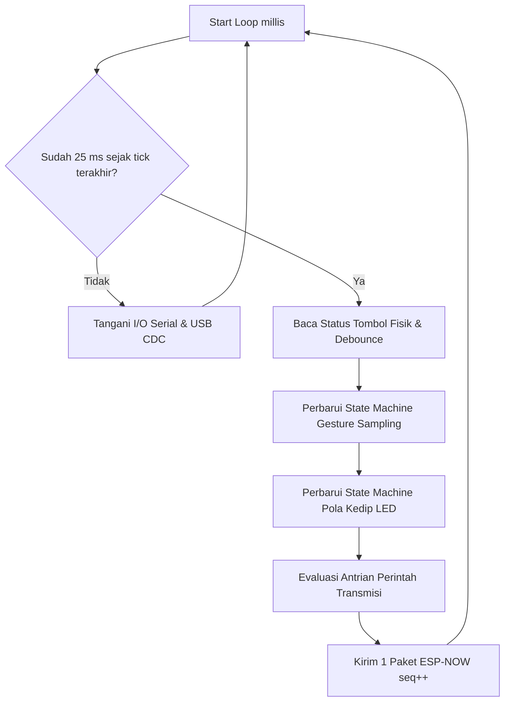
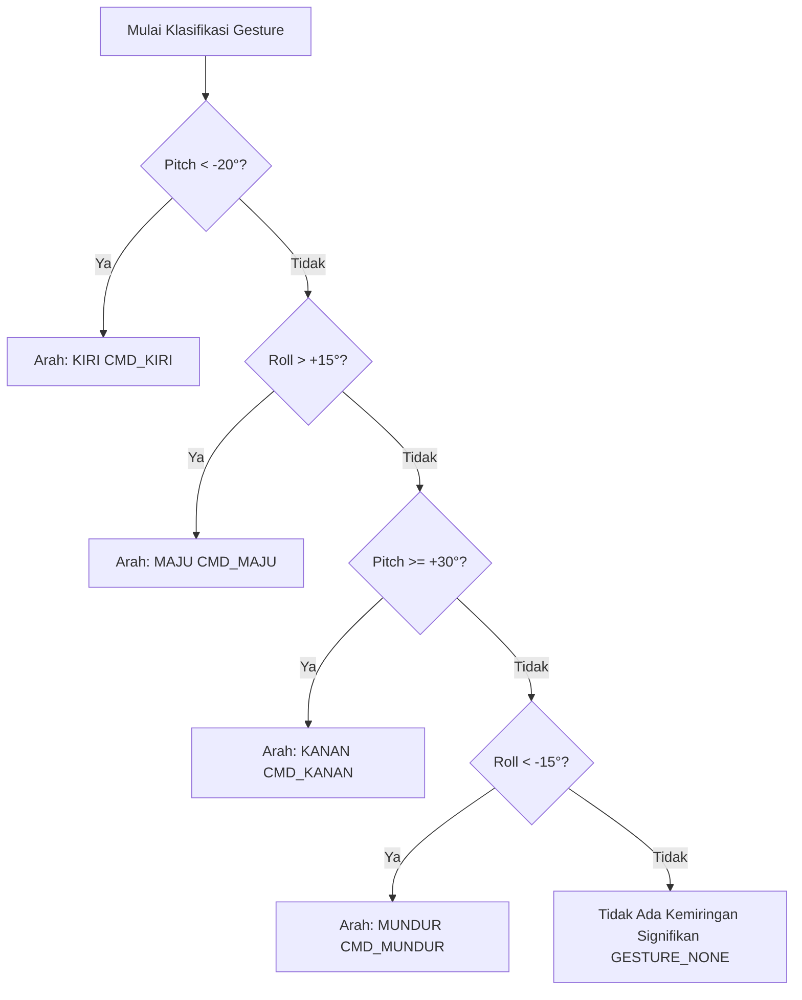

# Bab 2: Glove Controller (Sistem Sarung Tangan Cerdas)

Dokumen ini membedah arsitektur internal pengontrol nirkabel sarung tangan (**Glove Controller**) yang dibangun di atas mikrokontroler **ESP32-C3 SuperMini**. Glove Controller berfungsi sebagai pemancar perintah utama yang menerjemahkan tekanan tombol fisik dan gestur kemiringan tangan menjadi paket biner terenkapsulasi ESP-NOW.

---

## 2.1 Arsitektur Loop Utama Non-Blocking (40 Hz / 25 ms)

Glove Controller dirancang tanpa sistem operasi FreeRTOS terpisah; firmware beroperasi dalam loop tunggal non-blocking (*super-loop*) dengan periodisitas tepat **25 ms** ($40\text{ Hz}$).

### Mengapa Non-Blocking?
Pada aplikasi nirkabel, setiap penundaan (*blocking delay*) seperti penggunaan `delay(500)` akan menghentikan pengiriman paket ke drone. Jika pengiriman terhenti melebihi batas waktu failsafe ($2.000\text{ ms}$), drone akan menganggap koneksi putus dan membatalkan penerbangan. Oleh karena itu, seluruh fungsi di Glove Controller (debounce tombol, kedipan LED, sampling sensor, dan transmisi paket) menggunakan penghitung waktu berbasis `millis()`.



---

## 2.2 Sistem Tombol & Logika Navigasi

Glove Controller dilengkapi 3 tombol sentuh (*tactile switch*) dengan resistor pull-up aktif LOW:

| Tombol | Pin GPIO | Perintah Biner | Deskripsi Fungsi |
|---|:---:|:---:|---|
| **BTN_ARM_LAND** | GPIO 1 | `CMD_BTN_ARM_LAND (10)` | Toggle dua fungsi: Meng-ARM drone saat di lantai, atau memulai pendaratan terkontrol saat sedang terbang (*auto-landing*). |
| **BTN_EMERGENCY**| GPIO 4 | `CMD_BTN_EMERGENCY (11)`| Sakelar darurat instan (*Kill Switch*): Mematikan semua motor seketika ($1.000\ \mu\text{s}$) dalam situasi bahaya. |
| **BTN_READY** | GPIO 10 | `CMD_BTN_READY (12)` | Mengaktifkan jendela sampling sensor IMU untuk membaca kemiringan gestur tangan pilot selama 250 ms. |

### Penjaga Validitas Tombol READY (*Ready Guard*):
Tombol `READY` tidak dapat dipicu sembarangan:
1. Controller secara pasif menerima status terbaru dari drone via downlink broadcast ESP-NOW.
2. Jika status drone masih `DRONE_DISARMED`, penekanan tombol `READY` akan langsung **ditolak** oleh controller.
3. LED Merah akan berkedip 3 kali (*Reject Blink*), dan suara/serial akan menampilkan pesan penolakan: `[GESTURE] Ditolak: Drone belum ARMED!`.
4. Gestur hanya dapat dikirim jika drone berstatus `DRONE_ARMED` atau `DRONE_FLYING`.

---

## 2.3 Sensor IMU & Algoritma Pengenalan Gesture

Sensor MPU-6050 pada sarung tangan membaca pergerakan sudut pergelangan tangan pilot.

### A. Pengondisian Sinyal & Orientasi Sumbu
Karena posisi pemasangan modul sensor MPU-6050 pada sarung tangan dapat bervariasi (terbalik atau miring), firmware menyediakan makro kalibrasi dan pemetaan sumbu di `config.h`:
```cpp
#define GLOVE_PITCH_SIGN -1
#define GLOVE_ROLL_SIGN  -1
#define GLOVE_SWAP_AXES  0
```
Setelah pembacaan roll dan pitch mentah, orientasi disesuaikan:
$$\text{Pitch}_{\text{final}} = \text{Pitch}_{\text{raw}} \times \text{GLOVE\_PITCH\_SIGN}$$
$$\text{Roll}_{\text{final}} = \text{Roll}_{\text{raw}} \times \text{GLOVE\_ROLL\_SIGN}$$

### B. Algoritma Jendela Sampling (250 ms Window)
Ketika tombol `READY` ditekan valid:
1. State gestur berubah menjadi `s_active = true`.
2. Selama rentang waktu $250\text{ ms}$ (`GESTURE_SAMPLE_MS`), sistem mengakumulasi rata-rata sudut kemiringan tangan:
   $$\text{Roll}_{\text{avg}} = \frac{\sum \text{Roll}}{N}, \quad \text{Pitch}_{\text{avg}} = \frac{\sum \text{Pitch}}{N}$$
3. Begitu jendela $250\text{ ms}$ berakhir, fungsi `decide()` mengklasifikasikan arah berdasarkan threshold sudut:



### C. Umpan Balik Hasil Gesture
- **Jika Terdeteksi Arah Valid (MAJU / MUNDUR / KIRI / KANAN):**  
  LED Hijau berkedip 2 kali (*Success Blink*). Perintah arah dimasukkan ke antrian pengiriman nirkabel.
- **Jika Tangan Netral / Threshold Tidak Tercapai:**  
  LED Merah berkedip 2 kali (*Reject Blink*). Tidak ada perintah arah yang dikirim ke drone.

---

## 2.4 Sistem Antarmuka Pengguna (LED UI Feedback)

Dua buah LED (Hijau di GPIO 5 dan Merah di GPIO 3) memberikan informasi visual status sistem secara instan kepada pilot:

| Pola LED | Kondisi / Status Sistem |
|---|---|
| **Merah Kedip Cepat Kontinu (5 Hz)** | IMU Sarung Tangan Error / Bus I2C gagal membaca sensor. |
| **Merah Nyala Konstan** | Drone dalam status `DRONE_DISARMED` atau koneksi ke drone terputus (> 2 detik). |
| **Hijau Nyala Konstan** | Drone berhasil `DRONE_ARMED` atau `DRONE_FLYING` dan terhubung stabil. |
| **Hijau Berkedip Cepat (Blink 2x)** | Gestur tangan berhasil terdeteksi dan dikirim ke drone. |
| **Merah Berkedip Cepat (Blink 2x / 3x)** | Gestur ditolak (tangan kurang miring atau drone belum dalam kondisi terbang). |
| **Hijau & Merah Berkedip Bergantian** | Mode kalibrasi IMU sedang berlangsung. |

---

## 2.5 Mekanisme Transmisi Paket & Heartbeat

Glove Controller mengirimkan **tepat satu paket ESP-NOW setiap 25 ms** ($40\text{ Hz}$).

### Mengapa Heartbeat Sangat Penting?
Drone dilengkapi penghitung waktu *failsafe watchdog* ($2.000\text{ ms}$). Jika pengontrol hanya mengirim data saat tombol ditekan, drone akan mengalami timeout saat pilot sedang diam. Oleh karena itu:
1. **Saat Tidak Ada Aksi (Idle):**  
   Glove Controller secara rutin mengirimkan paket dengan `command = CMD_NONE (0)`. Paket ini bertindak sebagai **Heartbeat / Ping**, memberi tahu drone bahwa pemancar dalam kondisi hidup dan berada dalam jangkauan.
2. **Saat Ada Tombol atau Gesture:**  
   Perintah penting (seperti `CMD_MAJU` atau `CMD_BTN_ARM_LAND`) dikirim secara berulang (*burst*) selama beberapa siklus tick (misal 3-5 tick berturut-turut) untuk mengantisipasi potensi paket hilang di udara (*packet drop*).
3. **Pembatas Jeda Perintah (*Forced None Ticks*):**  
   Setelah perintah burst selesai, sistem secara wajib menyisipkan minimal **2 tick `CMD_NONE`** sebelum perintah berikutnya boleh dikirim. Hal ini memastikan FSM drone dapat membedakan dengan jelas antara dua penekanan tombol terpisah.
4. **Sequence Numbering (`seq`):**  
   Setiap kali paket dikirim (baik heartbeat maupun perintah aktif), nilai `seq` selalu bertambah 1 (`seq++`). Drone mencatat sequence number terakhir untuk menolak paket duplikat yang datang akibat pantulan sinyal radio.
