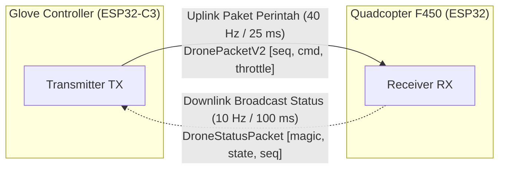

# Bab 3: Protokol Komunikasi ESP-NOW & Solusi Masalah Sinyal Putus

Dokumen ini menjelaskan secara komprehensif cara kerja protokol nirkabel **ESP-NOW**, struktur paket data biner, analisis mendalam akar masalah sinyal yang sering terputus (*connection drops / packet loss*), serta perbaikan definitif yang telah diterapkan pada firmware **Quadcopter F450** dan **Glove Controller**.

---

## 3.1 Mengenal Protokol ESP-NOW

ESP-NOW adalah protokol komunikasi nirkabel berbasis *connectionless* (tanpa koneksi/handshake berkelanjutan) yang dikembangkan oleh Espressif Systems. Protokol ini beroperasi pada pita frekuensi **2.4 GHz** (menggunakan frame MAC IEEE 802.11 yang disederhanakan), namun **tidak memerlukan perantara router atau Access Point (AP)**.



### Keunggulan Utama ESP-NOW:
1. **Latensi Sangat Rendah:** Transmisi paket langsung dari satu chip radio ke chip radio lain membutuhkan waktu $< 3\text{ ms}$ (jauh lebih cepat dibandingkan WiFi TCP/UDP yang berkisar $20\text{--}80\text{ ms}$).
2. **Paket Ringan (*Low Overhead*):** Paket data biner murni tanpa header IP atau TCP yang memakan bandwidth.
3. **Komunikasi Peer-to-Peer:** Kedua perangkat langsung berkomunikasi berdasarkan alamat MAC perangkat tujuan (atau mode broadcast `FF:FF:FF:FF:FF:FF`).

---

## 3.2 Format Struktur Paket Biner Data

Untuk menghindari masalah endianness dan padding memori antar prosesor yang berbeda arsitektur (Xtensa LX6 pada drone vs RISC-V pada glove), semua struktur paket biner menggunakan atribut `__attribute__((packed))`.

### A. Uplink Packet (Glove $\rightarrow$ Drone): `DronePacketV2`
Ukuran paket: **4 byte**
```cpp
struct __attribute__((packed)) DronePacketV2 {
    uint8_t  seq;       // 1 byte: Penghitung urutan paket (0 - 255) untuk deduplikasi
    uint8_t  command;   // 1 byte: Perintah kontrol (enum DroneCommand)
    uint16_t throttle;  // 2 byte: Nilai throttle manual (1000 - 1800 µs), 0 jika default
};
```

#### Nilai Enum Perintah (`DroneCommand`):
| Nilai Desimal | Konstanta Perintah | Keterangan Aksi |
|:---:|---|---|
| `0` | `CMD_NONE` | Heartbeat / Idle (tidak ada aksi fisik, sinyal hidup) |
| `1` | `CMD_MAJU` | Gesture maju (kemiringan pitch positif) |
| `2` | `CMD_MUNDUR` | Gesture mundur (kemiringan pitch negatif) |
| `3` | `CMD_KIRI` | Gesture geser kiri (kemiringan roll negatif) |
| `4` | `CMD_KANAN` | Gesture geser kanan (kemiringan roll positif) |
| `10`| `CMD_BTN_ARM_LAND` | Tombol ARM jika di lantai, atau tombol LAND jika terbang |
| `11`| `CMD_BTN_EMERGENCY`| Sakelar darurat (matikan seluruh motor seketika) |
| `12`| `CMD_BTN_READY` | Pemicu jendela deteksi gesture sarung tangan |

### B. Downlink Status Packet (Drone $\rightarrow$ Glove): `DroneStatusPacket`
Ukuran paket: **3 byte**
```cpp
struct __attribute__((packed)) DroneStatusPacket {
    uint8_t magic; // 1 byte: Byte validasi pengenal (selalu 0xA5)
    uint8_t state; // 1 byte: Status drone saat ini (enum DroneState)
    uint8_t seq;   // 1 byte: Sequence number konfirmasi dari drone
};
```

---

## 3.3 Investigasi Masalah: Mengapa ESP-NOW Sebelumnya Sering Terputus?

Pada pengujian awal, drone sering kali mengalami kondisi *failsafe* mendadak atau respon tombol tidak terbaca. Investigasi mendalam terhadap kedua codebase menemukan **4 akar masalah utama**:

### 🔴 Akar Masalah #1: Mode Penghematan Daya WiFi (*Modem Power Save*) Aktif Secara Default
- **Fakta Teknis:** Baik Arduino Core maupun ESP-IDF mengaktifkan fitur manajemen daya modem (`WIFI_PS_MIN_MODEM`) secara default untuk menghemat konsumsi baterai.
- **Dampaknya:** Radio RF 2.4 GHz pada ESP32 dan ESP32-C3 akan **mati (tidur)** selama interval DTIM beacon untuk menghemat energi, lalu bangun sesaat.
- **Konsekuensi Fatal:** Saat radio sedang "tidur", paket ESP-NOW yang dikirim dari glove tidak akan pernah sampai (*dropped packet*). Ketika 3–5 paket berturut-turut gagal diterima, batas waktu failsafe terlampaui dan drone menganggap remote mati/terputus!

### 🔴 Akar Masalah #2: Daya Pancar Radio (*TX Power*) Tidak Maksimal
- Secara default, daya pancar radio sering disetel pada nilai menengah ($11\text{--}13\text{ dBm}$).
- Saat pengoperasian di lingkungan nyata (adanya dinding, tubuh manusia, dan interferensi router WiFi 2.4 GHz di sekitar), sinyal radio mengalami atenuasi signifikan sehingga packet loss meningkat drastis.

### 🔴 Akar Masalah #3: Kanal Frekuensi (*WiFi Channel*) Melayang
- Jika kanal frekuensi tidak dikunci secara eksplisit di kedua modul, salah satu ESP32 dapat berpindah kanal secara dinamis atau default ke kanal yang berbeda dengan pasangannya. Komunikasi ESP-NOW hanya dapat terjadi jika pemancar dan penerima berada pada **kanal fisik yang sama**.

### 🔴 Akar Masalah #4: Blocking Operasi di Callback Interrupt (ISR)
- Fungsi callback penerima ESP-NOW (`onDataRecv`) dipanggil langsung dari konteks interrupt task WiFi. Melakukan operasi berat atau alokasi memori di callback dapat menyebabkan *watchdog timer crash* atau hilangnya paket berikutnya.

---

## 3.4 Solusi & Perbaikan Firmware yang Telah Diterapkan

Kedua file komunikasi (`ReceiverEspNow.cpp` pada drone dan `glove_comm.cpp` pada sarung tangan) telah diperbaiki dengan langkah-langkah rekayasa berikut:

### 1. Menonaktifkan Power Save Secara Permanen
```cpp
// Matikan sleep/power save WiFi agar modem RF selalu aktif 100% tanpa henti
esp_wifi_set_ps(WIFI_PS_NONE);
```
Dengan parameter `WIFI_PS_NONE`, modem radio 2.4 GHz di kedua perangkat menyala terus menerus (*always-on*), meniadakan jeda tidur yang sebelumnya menyebabkan koneksi terputus.

### 2. Mengunci Daya Pancar ke Nilai Maksimum (19.5 dBm)
```cpp
// Pada Drone (ESP32):
WiFi.setTxPower(WIFI_POWER_19_5dBm);

// Pada Glove (ESP32-C3):
esp_wifi_set_max_tx_power(78); // 78 unit = 19.5 dBm (level daya tertinggi ESP32)
```
Daya pancar $19.5\text{ dBm}$ memberikan margin sinyal (RSSI) yang jauh lebih kuat, menembus noise lingkungan 2.4 GHz dan mencegah putus sinyal akibat redaman tangan pilot.

### 3. Mengunci Kanal WiFi ke Kanal 1
```cpp
esp_wifi_set_channel(1, WIFI_SECOND_CHAN_NONE);
```
Memastikan kedua perangkat selalu bekerja pada frekuensi yang persis sama ($2.412\text{ GHz}$).

### 4. Implementasi Asynchronous Raw Ring Buffer pada Receiver Drone
Callback interrupt hanya bertugas menyalin data secara instan ke dalam ring buffer memori sirkular berkecepatan tinggi:
```cpp
void IRAM_ATTR ReceiverEspNow::onDataRecv(const uint8_t *mac, const uint8_t *data, int len) {
    if (len <= 0) return;
    portENTER_CRITICAL(&_rawMux);
    uint8_t nextHead = (_qHead + 1) % RAW_QUEUE_CAPACITY;
    if (nextHead != _qTail) {
        memcpy((void*)_rawQueue[_qHead].data, data, len);
        _rawQueue[_qHead].len = len;
        _qHead = nextHead;
    }
    portEXIT_CRITICAL(&_rawMux);
}
```
Core 0 CommTask kemudian memproses antrian ini secara tenang di luar interrupt, menjamin tidak ada paket yang tertindih atau hilang (*dropped*).

---

## 3.5 Log Verifikasi Diagnostik Saat Booting

Setelah firmware yang telah diperbaiki di-upload, Serial Monitor pada kedua board akan menampilkan konfirmasi parameter RF berikut:

**Serial Monitor Drone (ESP32):**
```text
[INIT] Menginisialisasi Receiver ESP-NOW...
[ESP-NOW] MAC Address Drone : 34:85:18:XX:XX:XX
[ESP-NOW] WiFi Channel Aktif: 1 | Power Save: NONE | Max TX Power: 19.5dBm
[ESP-NOW] Siap menerima paket dari Glove Controller.
```

**Serial Monitor Glove Controller (ESP32-C3):**
```text
[COMM] Inisialisasi ESP-NOW...
[ESP-NOW] MAC Address Glove: 84:F7:03:XX:XX:XX
[ESP-NOW] WiFi Channel: 1 | Power Save: NONE | TX Power: 19.5dBm
[COMM] ESP-NOW berhasil diinisialisasi.
```

Munculnya parameter **`Power Save: NONE`** dan **`TX Power: 19.5dBm`** di kedua sisi membuktikan bahwa celah pemutusan komunikasi telah ditutup sepenuhnya.
