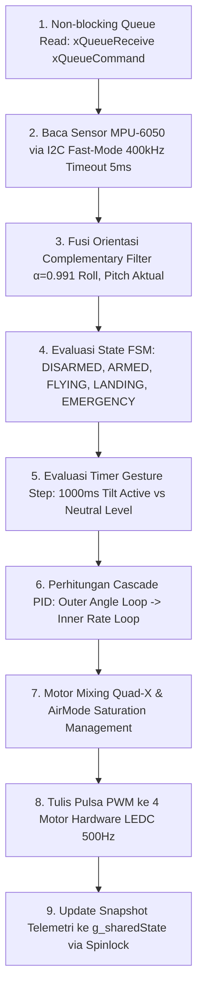

# Bab 4: Arsitektur Dual-Core FreeRTOS pada Quadcopter F450

Dokumen ini membedah rancangan sistem operasi waktu nyata (**FreeRTOS**) yang diterapkan pada mikrokontroler **ESP32-WROOM-32** di Quadcopter F450. Firmware memanfaatkan arsitektur dua inti fisik (*dual-core Xtensa LX6*) secara terpisah untuk memisahkan beban kerja komputasi kontrol penerbangan dari beban kerja komunikasi nirkabel.

---

## 4.1 Mengapa Memisahkan Tugas Antar-Core (AMP)?

Pada sistem kendali penerbangan multirotor, kestabilan terbang sangat bergantung pada **determinisme waktu**. Loop kontrol harus berjalan pada interval waktu yang sangat presisi (setiap $4.000\ \mu\text{s}$ atau $250\text{ Hz}$).

### Bahaya Menyatukan Komunikasi dan Kendali dalam Satu Core:
1. **Jitter Radio WiFi:** Tumpukan protokol jaringan (*network stack*) WiFi/ESP-NOW dapat memicu interrupt tak terduga yang berlangsung selama ratusan mikrodetik hingga beberapa milidetik.
2. **Operasi I/O Serial yang Memblokir:** Menulis teks diagnostik ke Serial UART dapat menahan jalannya prosesor (*blocking delay*).
3. **Risiko Osilasi dan Jatuh:** Jika satu siklus loop PID tertunda $10\text{ ms}$ saja karena sibuk menerima paket data radio, respons koreksi motor terlambat, menyebabkan drone berosilasi liar (*wobble*) dan jatuh seketika.

### Solusi: Asymmetric Multiprocessing (AMP)
Dengan FreeRTOS pada ESP32, kita menyematkan (*pin*) dua tugas mandiri pada inti prosesor yang berbeda:

```mermaid
flowchart TD
    subgraph ESP32["ESP32 Dual-Core Architecture"]
        subgraph Core0["CORE 0: Communication Task (commTask)"]
            direction TB
            A0[Prioritas 2 | Frekuensi 50 Hz | Periode 20 ms]
            A1[Penerimaan Paket ESP-NOW]
            A2[Deduplikasi Sequence Number]
            A3[Antarmuka Serial CLI Bench Test]
            A4[Broadcast Telemetri Downlink 10 Hz]
        end

        subgraph Core1["CORE 1: Flight Control Task (flightTask)"]
            direction TB
            B0[Prioritas 5 Max | Frekuensi 250 Hz | Periode 4.000 µs]
            B1[Pembacaan MPU-6050 I2C 400 kHz]
            B2[Fusi Sikap Complementary Filter]
            B3[Eksekusi Finite State Machine]
            B4[Dual-Loop Cascade PID Angle + Rate]
            B5[Motor Mixer Quad-X & Driver LEDC PWM]
        end

        subgraph IPC["Sinkronisasi & Inter-Process Communication (IPC)"]
            C1[FreeRTOS Command Queue xQueueCommand]
            C2[Shared Memory g_sharedState via portMUX Spinlock]
        end

        A1 & A3 -->|Kirim Perintah Baru| C1
        C1 -->|Terima Perintah Non-Blocking| B3
        B5 -->|Tulis Snapshot Status Telemetri| C2
        C2 -->|Baca Snapshot Non-Blocking| A4
    end
```

---

## 4.2 Spesifikasi & Alur Tugas Core 0: Comm Task

Tugas komunikasi berjalan pada Core 0 dengan parameter berikut:
- **Prioritas FreeRTOS:** `2` (Di bawah sistem kernel)
- **Frekuensi Loop:** `50 Hz` (Periode $20\text{ ms}$)
- **Ukuran Alokasi Stack:** `8192 byte`

### Alur Kerja di Setiap Siklus Comm Task (20 ms):
1. **Memeriksa Ring Buffer Raw ESP-NOW:**  
   Mengambil paket biner mentah yang dimasukkan oleh fungsi interrupt callback `onDataRecv()`.
2. **Deduplikasi Paket (*Sequence Check*):**  
   Mengecek apakah nomor urut `seq` sama dengan paket sebelumnya. Jika sama (duplikat), paket diabaikan. Jika baru, `lastPacketTime` diperbarui ke `millis()`.
3. **Enkapsulasi ke Command Queue:**  
   Jika paket berisi perintah aktif (misal `CMD_MAJU` atau `CMD_BTN_ARM_LAND`), perintah tersebut dimasukkan ke dalam antrian `xQueueCommand`.
4. **Membaca Perintah Serial Bench Test:**  
   Membaca karakter tombol dari keyboard Serial Monitor (misal karakter `1`, `2`, `3`, `w`, `s`, `+`, `-`, `c`) untuk keperluan pengujian di atas meja tanpa remote.
5. **Broadcast Telemetri Status (10 Hz):**  
   Setiap $100\text{ ms}$ ($10\text{ Hz}$), Comm Task membaca snapshot status drone dari memori bersama dan memancarkannya kembali ke Glove Controller via ESP-NOW.

---

## 4.3 Spesifikasi & Alur Tugas Core 1: Flight Task

Tugas kendali terbang adalah proses dengan prioritas tertinggi pada drone:
- **Prioritas FreeRTOS:** `5` (Tertinggi pada aplikasi pengguna)
- **Frekuensi Loop:** `250 Hz` (Periode tepat $4.000\ \mu\text{s}$)
- **Pewaktu Deterministik:** Menggunakan fungsi `vTaskDelayUntil()` berbasis clock hardware ESP32.
- **Ukuran Alokasi Stack:** `8192 byte`

### Struktur Eksekusi 9 Tahap dalam Setiap Siklus 4.000 µs:


### Pemantauan Kinerja (*Jitter & Deadline Tracking*):
Flight Task mengukur waktu eksekusinya secara internal menggunakan register pewaktu mikrodetik (`esp_timer_get_time()`):
- **Waktu Komputasi Rata-rata:** $\approx 750\text{--}900\ \mu\text{s}$ (menyisakan margin idle $>75\%$ dari anggaran waktu $4.000\ \mu\text{s}$).
- **Jitter Toleransi:** Jika durasi siklus melenceng melebihi $\pm 400\ \mu\text{s}$ dari target $4.000\ \mu\text{s}$, variabel `deadlineMissCount` akan bertambah untuk keperluan audit diagnostik.

---

## 4.4 Mekanisme Komunikasi Antar-Tugas (IPC)

Untuk menghubungkan kedua core tanpa saling menunggu (*zero blocking*), diterapkan dua mekanisme IPC standar FreeRTOS:

### 1. Antrian Perintah (*Command Queue*): `xQueueCommand`
- Tipe data: `DroneCommand` (1 byte enum).
- Kapasitas: `8 item` (`COMMAND_QUEUE_DEPTH`).
- Pengirim (Core 0): `xQueueSend(xQueueCommand, &cmd, 0)` $\rightarrow$ tidak pernah memblokir jika antrian penuh.
- Penerima (Core 1): `xQueueReceive(xQueueCommand, &cmd, 0)` $\rightarrow$ membaca instan dengan batas tunggu $0\text{ ms}$.

### 2. Memori Bersama Terproteksi Spinlock: `g_sharedState`
Data telemetri berukuran besar (sudut pitch/roll, output tiap motor, tegangan baterai, status failsafe) dibagikan menggunakan struktur data `SharedState`.

#### Mengapa Menggunakan Spinlock (`portMUX_TYPE`), Bukan Mutex?
Pada sistem multi-core berkecepatan tinggi:
- **FreeRTOS Mutex:** Memerlukan operasi *context switch*, penundaan task, dan manajemen prioritas (*priority inheritance*). Jika Core 1 menunggu mutex yang sedang dipegang Core 0, loop $250\text{ Hz}$ akan terlewat (*deadline miss*).
- **PortMUX Spinlock:** Menggunakan instruksi CPU atomic hardware. Inti prosesor hanya mengunci interupsi lokal selama beberapa siklus instruksi perakitan (*nanodetik*), menjamin pertukaran data yang sangat cepat dan bebas dari race condition:
```cpp
portENTER_CRITICAL(&g_sharedMux);
g_sharedState.telemetry = t; // Operasi salin memori instan
portEXIT_CRITICAL(&g_sharedMux);
```
