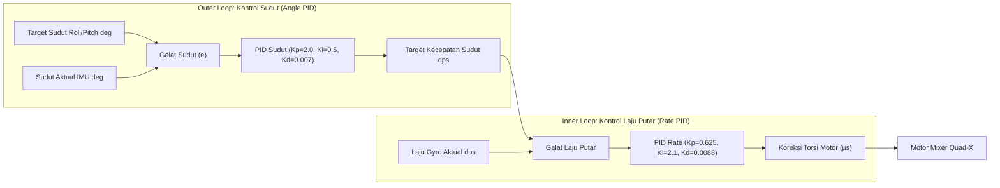

# Bab 5: Estimasi Sikap IMU, Kendali Cascade PID & Motor Mixer

Dokumen ini menjelaskan secara matematis dan implementatif bagaimana sensor IMU **InvenSense MPU-6050** diolah, bagaimana algoritma **Dual-Loop Cascade PID** menjaga kestabilan terbang drone F450, serta bagaimana matriks **Motor Mixer Quad-X** mendistribusikan tenaga ke empat motor brushless.

---

## 5.1 Pengolahan Sensor IMU MPU-6050

Sensor MPU-6050 menggabungkan Giroskop 3-sumbu dan Akselerometer 3-sumbu dalam satu chip yang berkomunikasi melalui antarmuka **I2C Fast-Mode 400 kHz** (SDA: GPIO 21, SCL: GPIO 22).

### A. Konfigurasi Register & Filter Perangkat Keras (DLPF)
Getaran mekanis dari putaran baling-baling $10\text{ inci}$ dan motor 1000KV dapat memicu derau (*noise*) frekuensi tinggi pada giroskop. Oleh karena itu, diaktifkan filter analog/digital internal:
- **Digital Low Pass Filter (DLPF):** Register `0x1A = 0x03` $\rightarrow$ memotong frekuensi di atas $\approx 44\text{ Hz}$.
- **Sensitivitas Giroskop:** Register `0x1B = 0x08` ($\pm 500^\circ/\text{s}$ rentang penuh, skala konversi $65.5\text{ LSB}/(^\circ/\text{s})$).
- **Sensitivitas Akselerometer:** Register `0x1C = 0x10` ($\pm 8\text{g}$ rentang penuh, skala konversi $4096\text{ LSB}/\text{g}$).

### B. Proteksi Batas Waktu I2C (*I2C Timeout Guard*)
Jika bus I2C mengalami gangguan listrik statis (*glitch*), driver standar Wire dapat terkunci tanpa batas waktu (*freeze*). Pada firmware ini:
- Timeout transaksi I2C dibatasi maksimal **$5\text{ ms}$** (`I2C_TIMEOUT_MS`).
- Toleransi kegagalan berturut-turut dibatasi maksimal **5 kali** (`MAX_IMU_FAIL_COUNT`). Jika sensor tidak merespons setelah 5 siklus beruntun, flag `imuHealthy` akan menjadi `false` dan FSM mematikan motor secara aman.

---

## 5.2 Fusi Orientasi Sikap (Complementary Filter)

Akselerometer rentan terhadap akselerasi linear getaran baling-baling, namun tidak mengalami hanyutan jangka panjang (*long-term drift*). Sebaliknya, giroskop sangat presisi dalam jangka pendek tetapi rentan terhadap pergeseran nilai integrasi (*drift*).

Kedua sensor digabungkan menggunakan **Complementary Filter** dengan faktor bobot $\alpha = 0.991$ pada frekuensi $250\text{ Hz}$ ($\Delta t = 0.004\text{ detik}$):

$$\theta_{\text{acc}} = \arctan2\left(\frac{A_y}{\sqrt{A_x^2 + A_z^2}}\right) \times \frac{180^\circ}{\pi}$$

$$\theta_{\text{aktual}}(t) = \alpha \cdot \Big(\theta_{\text{aktual}}(t - \Delta t) + \omega_{\text{gyro}} \cdot \Delta t\Big) + (1 - \alpha) \cdot \theta_{\text{acc}}$$

Dengan $\alpha = 0.991$, filter memberikan bobot $99.1\%$ pada integrasi giroskop yang mulus dan bebas getaran, serta $0.9\%$ koreksi akselerometer per siklus loop untuk mengeliminasi drift. Sudut hasil estimasi dibatasi (*clamped*) pada rentang $\pm 85^\circ$ untuk mencegah singularitas trigonometri.

---

## 5.3 Skema Kendali Dual-Loop Cascade PID

Quadcopter F450 menggunakan arsitektur **Cascade PID (Dual-Loop)** terpisah untuk sumbu **Roll** dan **Pitch**, serta Single-Loop Rate PID untuk sumbu **Yaw**.



### Mengapa Menggunakan Cascade (Dua Loop)?
1. **Outer Loop (Angle Loop):**  
   Menjaga drone tetap horizontal atau mempertahankan kemiringan yang diminta pilot. Loop ini menghasilkan output berupa *target laju putaran* yang diinginkan (derajat per detik / $\text{dps}$).
2. **Inner Loop (Rate Loop):**  
   Bekerja langsung pada nilai mentah giroskop. Loop ini bertindak sebagai peredam dinamis (*damping*) yang merespons secara instan terhadap hembusan angin atau turbulensi sebelum drone sempat berubah posisi kemiringannya secara signifikan.

### Parameter Gain PID yang Diterapkan:
| Sumbu | Loop | Kp (Proporsional) | Ki (Integral) | Kd (Derivatif) | Output Satuan |
|---|:---:|:---:|:---:|:---:|:---:|
| **Roll** | Outer (Angle) | $2.000$ | $0.500$ | $0.0070$ | Target $\text{dps}$ |
| **Roll** | Inner (Rate)  | $0.625$ | $2.100$ | $0.0088$ | Koreksi $\mu\text{s}$ |
| **Pitch**| Outer (Angle) | $2.000$ | $0.500$ | $0.0070$ | Target $\text{dps}$ |
| **Pitch**| Inner (Rate)  | $0.625$ | $2.100$ | $0.0088$ | Koreksi $\mu\text{s}$ |
| **Yaw**  | Single (Rate) | $4.000$ | $3.000$ | $0.0000$ | Koreksi $\mu\text{s}$ |

### Fitur Perlindungan PID:
- **Anti-Windup Integral:** Nilai akumulasi integral dibatasi secara ketat untuk mencegah penumpukan nilai saat motor mengalami saturasi atau sebelum drone terangkat dari lantai.
- **D-Term on Measurement:** Perhitungan derivatif dihitung berdasarkan perubahan nilai gyro aktual (bukan perubahan setpoint), mencegah lonjakan output mendadak (*derivative kick*) saat target berubah.
- **Clamping Saturasi Output:** Total koreksi PID dibatasi maksimal $\pm 400\ \mu\text{s}$.

---

## 5.4 Motor Mixing Matrix (Konfigurasi Quad-X)

Output gabungan dari Base Throttle dan koreksi PID didistribusikan ke masing-masing dari keempat motor dengan persamaan matriks berikut:

```text
                  DEPAN (HIDUNG DRONE)
                         ▲
                         │
             [M4] FL     │     [M1] FR
            (Putar: CW)  │   (Putar: CCW)
                   \     │     /
                    \    │    /
                     \───────/
                     │   FC  │
                     /───────\
                    /    │    \
                   /     │     \
             [M3] RL     │     [M2] RR
            (Putar: CCW) │   (Putar: CW)
                         │
```

$$\begin{aligned}
\text{PWM}_{M1\text{ (FR)}} &= \text{Throttle} - \text{Roll}_{\text{PID}} - \text{Pitch}_{\text{PID}} - \text{Yaw}_{\text{PID}} \\
\text{PWM}_{M2\text{ (RR)}} &= \text{Throttle} - \text{Roll}_{\text{PID}} + \text{Pitch}_{\text{PID}} + \text{Yaw}_{\text{PID}} \\
\text{PWM}_{M3\text{ (RL)}} &= \text{Throttle} + \text{Roll}_{\text{PID}} + \text{Pitch}_{\text{PID}} - \text{Yaw}_{\text{PID}} \\
\text{PWM}_{M4\text{ (FL)}} &= \text{Throttle} + \text{Roll}_{\text{PID}} - \text{Pitch}_{\text{PID}} + \text{Yaw}_{\text{PID}}
\end{aligned}$$

### Verifikasi Logika Tanda Mixer:
1. **Roll Positif (Miring ke Kanan):**  
   Motor kiri ($M3, M4$) mendapatkan tambahan daya $+$, motor kanan ($M1, M2$) mendapatkan pengurangan daya $-$. Hasil: Drone miring ke kanan.
2. **Pitch Positif (Hidung Menunduk / Maju):**  
   Motor belakang ($M2, M3$) bertambah $+$, motor depan ($M1, M4$) berkurang $-$. Hasil: Drone condong ke depan dan melaju maju.
3. **Yaw Positif (Putar Hidung ke Kanan):**  
   Motor berputar CW ($M2, M4$) bertambah $+$, motor berputar CCW ($M1, M3$) berkurang $-$. Melalui hukum aksi-reaksi kekekalan momentum sudut (*torque reaction*), badan drone berputar ke kanan.

### Manajemen Saturasi (AirMode Logic)
Jika salah satu nilai pulsa motor melebihi batas $1.999\ \mu\text{s}$ atau jatuh di bawah batas idle $1.170\ \mu\text{s}$, algoritma mixer melakukan kompensasi dinamis pada throttle dasar agar proporsi koreksi Roll/Pitch tetap terjaga, mencegah drone kehilangan kendali sikap (*loss of attitude authority*).

---

## 5.5 Eksekusi Gerakan Satu Langkah (Step Gesture)

Ketika perintah arah diterima dari sarung tangan (misal `CMD_MAJU`):
1. Sistem mengaktifkan jendela manuver selama $1.000\text{ ms}$ (`GESTURE_STEP_DURATION_MS`).
2. Target sudut pitch diubah dari $0.0^\circ$ menjadi $+4.0^\circ$ (`GESTURE_TILT_ANGLE`).
3. Transisi sudut diperhalus menggunakan filter eksponensial (*Smooth Ramping*):
   $$\theta_{\text{target\_smooth}} = \theta_{\text{target\_smooth}} + \text{TILT\_RAMP\_RATE} \cdot (\theta_{\text{target}} - \theta_{\text{target\_smooth}})$$
4. Throttle secara otomatis dinaikkan sebesar $+80\ \mu\text{s}$ (`GESTURE_THROTTLE_BOOST`) untuk mengimbangi penurunan gaya angkat (*lift loss*) akibat badan drone yang miring.
5. Setelah $1.000\text{ ms}$ berlalu, target sudut otomatis kembali ke $0.0^\circ$ dan throttle kembali ke nilai hover normal, menghentikan laju drone dan mengembalikannya ke posisi mengambang seimbang (*level hover*).
