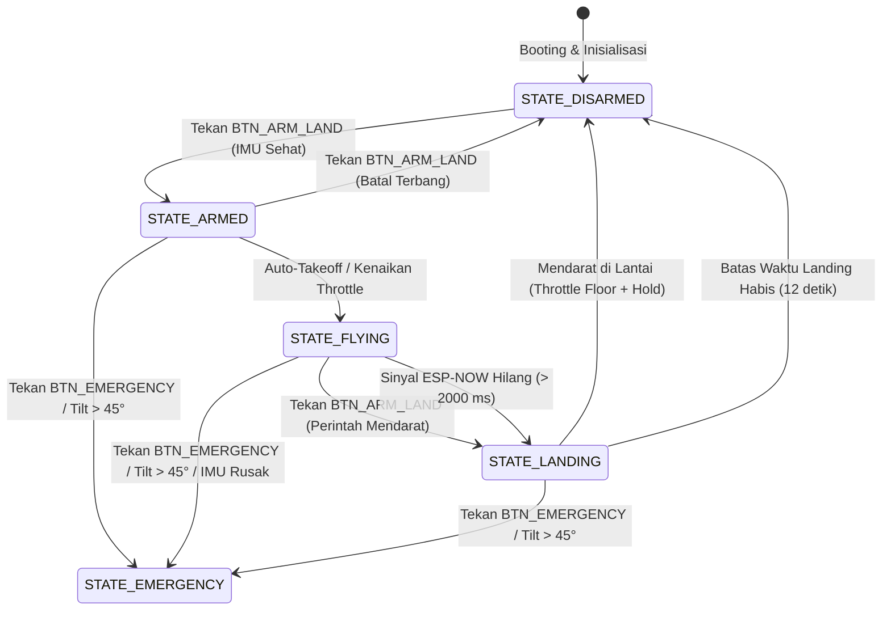
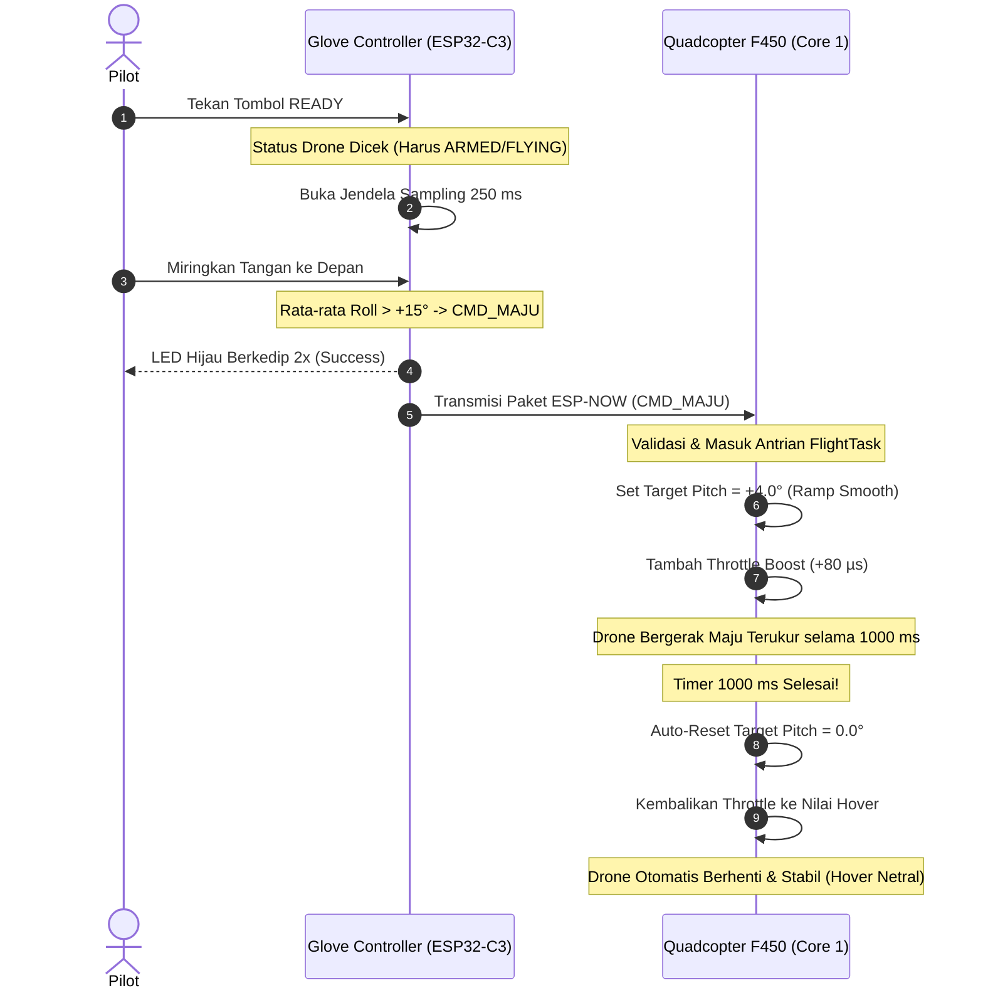

# Bab 6: Finite State Machine (FSM) & Sistem Keamanan Failsafe

Dokumen ini mendokumentasikan mesin status (**Finite State Machine / FSM**) pada Flight Controller Quadcopter F450 serta lapisan-lapisan proteksi keselamatan (*multi-tier failsafe*) yang dirancang untuk mencegah terjadinya terbang liar (*flyaway*) atau kecelakaan (*crash*).

---

## 6.1 Siklus Hidup Status Drone (Finite State Machine)

Seluruh logika operasional drone dikendalikan oleh variabel status `DroneState` yang dieksekusi secara lokal di dalam Core 1:

---

## 6.2 Bedah Detail Setiap Status (State Breakdown)

### 1. `STATE_DISARMED` (Kondisi Diam Aman)
- **Output ESC:** Seluruh motor dimatikan ke pulsa minimum $1.000\ \mu\text{s}$ (`PWM_MIN / PWM_ARM`).
- **Sistem Kendali:** Akumulator integral PID di-reset ke $0$ untuk mencegah akumulasi sebelum terbang.
- **Kondisi Masuk:** Kondisi awal saat booting, setelah pendaratan selesai, atau setelah tombol darurat ditekan.
- **Transisi ke ARMED:** Hanya diizinkan jika tombol `CMD_BTN_ARM_LAND` ditekan **DAN** sensor MPU-6050 dalam kondisi terkalibrasi serta sehat (`imuHealthy == true`).

### 2. `STATE_ARMED` (Siaga / Motor Berputar Lambat)
- **Output ESC:** Motor berputar perlahan pada batas aman $1.170\ \mu\text{s}$ (`PWM_IDLE`).
- **Tujuan:** Memberikan konfirmasi visual dan audio yang jelas kepada pilot bahwa drone telah aktif dan siap terbang.
- **Fitur Keselamatan:** Jika pilot tidak menaikkan throttle atau tidak memicu takeoff dalam waktu tertentu, atau jika sinyal hilang saat berada di lantai, sistem akan kembali otomatis ke status `DISARMED`.

### 3. `STATE_FLYING` (Terbang Aktif & Kontrol Gestur)
- **Lepas Landas Halus (*Smooth Takeoff Ramp*):** Throttle dinaikkan secara bertahap dengan kecepatan $+120\ \mu\text{s/detik}$ (`TAKEOFF_RAMP_PER_SEC`) hingga mencapai ketinggian terbang mengambang ($1.300\ \mu\text{s}$ `HOVER_THROTTLE`).
- **Kendali Aktif:** Kontroler Cascade PID beroperasi penuh menstabilkan sudut Roll, Pitch, dan laju Yaw.
- **Eksekusi Manuver Gestur:** Pada status ini, perintah dari Glove Controller (`CMD_MAJU`, `CMD_MUNDUR`, `CMD_KIRI`, `CMD_KANAN`) diterima dan dieksekusi selama jendela $1.000\text{ ms}$.

### 4. `STATE_LANDING` (Pendaratan Otomatis Terkendali)
- **Sikap Datar Otomatis:** Target sudut roll dan pitch langsung dikunci ke $0.0^\circ$ (badan drone dipaksa horizontal sempurna).
- **Penurunan Throttle Bertahap:** Throttle diturunkan secara mulus dengan laju $-80\ \mu\text{s/detik}$ (`LANDING_THROTTLE_DROP_PER_SEC`).
- **Deteksi Sentuh Tanah (*Floor Touchdown*):** Throttle turun hingga mencapai batas bawah $1.050\ \mu\text{s}$ (`LANDING_THROTTLE_FLOOR`), lalu ditahan selama $2.000\text{ ms}$ (`FAILSAFE_FLOOR_HOLD_MS`) untuk memastikan drone sudah stabil menjejak tanah sebelum motor dimatikan sepenuhnya (`DISARMED`).
- **Batas Waktu Darurat Pendaratan:** Dilengkapi *hard timeout* $12\text{ detik}$ (`FAILSAFE_LANDING_TIMEOUT_MS`); jika dalam 12 detik drone belum selesai mendarat, motor akan dipaksa mati untuk mencegah motor terus berputar jika tersangkut.

### 5. `STATE_EMERGENCY` (Pemutusan Daya Seketika / Kill Switch)
- **Output ESC:** Seluruh motor diputus seketika ke $1.000\ \mu\text{s}$ dalam waktu $< 4\text{ ms}$.
- **Pemicu:** Tombol darurat `BTN_EMERGENCY` ditekan, tombol keyboard serial `'2'`, atau proteksi hardware terlampaui.
- **Karakteristik:** State ini mengunci seluruh kendali; drone tidak dapat di-ARM kembali tanpa me-reboot mikrokontroler.

---

## 6.3 Matriks Proteksi Failsafe Berlapis (Multi-Tier Failsafe)

Untuk menjamin keselamatan terbang, firmware menerapkan 4 lapisan proteksi otomatis:

| Lapisan Proteksi | Kondisi Pemicu | Respon Sistem | Konsekuensi & Tujuan |
|---|---|---|---|
| **Tier 1: Sinyal ESP-NOW Hilang** | Tidak ada paket valid selama $> 2.000\text{ ms}$ | Masuk ke `STATE_LANDING` otomatis | Drone tidak terbang melayang terbawa angin; drone mendarat perlahan di posisi terakhirnya. |
| **Tier 2: Kemiringan Ekstrem (*Flip Guard*)** | Sudut kemiringan Roll atau Pitch $> 45.0^\circ$ | Seketika masuk ke `STATE_EMERGENCY` (Motor Cut) | Mencegah baling-baling mencabik lantai atau objek sekitar jika drone terbalik/menabrak rintangan. |
| **Tier 3: Sensor IMU Rusak / Hang** | Pembacaan I2C gagal $> 5$ kali berturut-turut | Seketika masuk ke `STATE_EMERGENCY` | Mencegah motor berputar tak terkendali akibat hilangnya umpan balik orientasi sikap. |
| **Tier 4: Tombol Darurat Manual** | Tombol `BTN_EMERGENCY` ditekan oleh pilot | Seketika masuk ke `STATE_EMERGENCY` | Pilot memegang kendali tertinggi (*Kill Switch*) jika terjadi situasi darurat di luar dugaan. |

---

## 6.4 Logika Eksekusi Gestur Satu Langkah (Step Gesture Execution)

Diagram alur berikut mengilustrasikan siklus lengkap dari satu penekanan tombol `READY` hingga drone kembali ke posisi hover netral:

