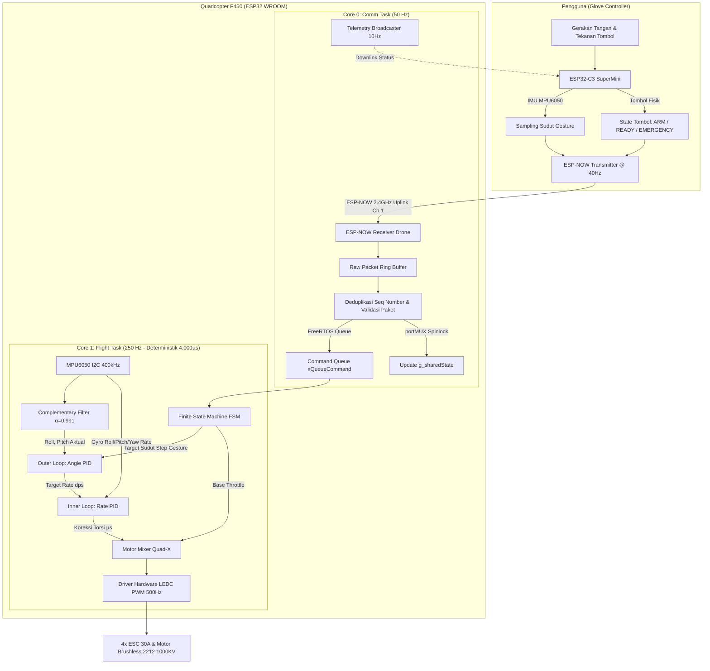

# Dokumentasi Sistem Terintegrasi: Quadcopter F450 & Glove Controller

Selamat datang di repositori dokumentasi lengkap sistem **Quadcopter F450** berbasis **ESP32 Dual-Core** dan pengontrol nirkabel sarung tangan **Glove Controller** berbasis **ESP32-C3**.

Dokumentasi ini disusun secara terstruktur, mendalam, dan dilengkapi dengan diagram alur serta analisis kode agar pembaca—baik mahasiswa, teknisi, maupun pengembang sistem tertanam (*embedded system*)—dapat memahami seluruh konsep dan mekanisme kerja proyek ini secara menyeluruh dari hulu ke hilir.

---

## 📚 Struktur Dokumen

Dokumentasi ini dibagi menjadi beberapa bab terpisah yang saling melengkapi:

| No | Modul / Dokumen | Deskripsi Isi Pembahasan |
|:--:|---|---|
| **01** | [**01. Arsitektur & Ikhtisar Sistem**](01_arsitektur_dan_ikhtisar_sistem.md) | Visi sistem, filosofi kendali satu langkah (*step-by-step gesture*), perbandingan mikrokontroler (ESP32 vs ESP32-C3), diagram blok interkoneksi, dan spesifikasi komponen fisik. |
| **02** | [**02. Glove Controller (Sarung Tangan)**](02_glove_controller_sarung_tangan.md) | Arsitektur event loop 40 Hz non-blocking pada ESP32-C3, sistem tombol navigasi (ARM, EMERGENCY, READY), akuisisi IMU MPU-6050 sarung tangan, algoritma inferensi gesture, dan umpan balik LED status. |
| **03** | [**03. Protokol Komunikasi ESP-NOW**](03_protokol_komunikasi_espnow.md) | Penjelasan mendalam protokol nirkabel 2.4 GHz ESP-NOW, format biner paket (`DronePacketV2` & `DroneStatusPacket`), **investigasi akar masalah sinyal sering terputus** (WiFi Modem Sleep), solusi parameter RF, dan manajemen paket raw ring buffer. |
| **04** | [**04. Quadcopter Dual-Core FreeRTOS**](04_quadcopter_dual_core_freertos.md) | Pemisahan beban kerja Asymmetric Multiprocessing (AMP): Core 0 (CommTask 50 Hz) vs Core 1 (FlightTask 250 Hz deterministik 4.000 µs), serta mekanisme sinkronisasi IPC (*Queue* & *Spinlock Shared Memory*). |
| **05** | [**05. Estimasi Sikap IMU & Cascade PID**](05_estimasi_sikap_imu_dan_kendali_pid.md) | Pengolahan sensor MPU-6050 (DLPF 44 Hz, Fast-Mode I2C), fusi sikap *Complementary Filter* ($\alpha = 0.991$), arsitektur kontrol *Dual-Loop Cascade PID* (Angle Outer + Rate Inner), dan perumusan matriks mixer motor Quad-X. |
| **06** | [**06. Finite State Machine & Keamanan**](06_finite_state_machine_dan_keamanan.md) | Siklus hidup status drone (DISARMED $\rightarrow$ ARMED $\rightarrow$ FLYING $\rightarrow$ LANDING $\rightarrow$ EMERGENCY), logika eksekusi gesture terukur (500 ms tilt + auto level), dan sistem keselamatan failsafe bertingkat (sinyal putus, IMU timeout, kemiringan ekstrem). |
| **07** | [**07. Panduan Operasional & Pengujian**](07_panduan_operasional_dan_pengujian.md) | Langkah-langkah kompilasi/upload PlatformIO, kalibrasi sensor, pengujian meja (*bench test*) via antarmuka Serial CLI tanpa baling-baling, verifikasi respons mixer motor, prosedur uji terbang aman (*tether test*), dan tabel pemecahan masalah (*troubleshooting*). |

---

## 🗺️ Peta Alur Kerja Sistem End-to-End

Berikut adalah gambaran besar (*big picture*) alur data dari tangan pengguna hingga baling-baling drone:

---

## 💡 Konsep Inti yang Membedakan Sistem Ini

1. **Kendali Bertahap / Satu Langkah (*Step-by-Step Gesture Control*)**
   - Bukan kendali proporsional berkelanjutan yang berisiko membuat drone hilang kendali karena tangan bergetar atau lelah.
   - 1 kali tombol `READY` ditekan $\rightarrow$ membaca kemiringan tangan selama 250 ms $\rightarrow$ drone melakukan manuver terukur kemiringan $4^\circ$ selama 1.000 ms dengan kompensasi *throttle boost* otomatis $\rightarrow$ drone kembali otomatis ke posisi datar seimbang (*level hover*).
2. **Pemisahan Beban Dual-Core (Asymmetric Multiprocessing)**
   - Proses komunikasi radio, pemrosesan serial, dan broadcast telemetri tidak pernah mengganggu loop kendali penerbangan.
   - Core 1 memiliki determinisme tinggi pada interval $4.000\ \mu\text{s}$ ($250\text{ Hz}$) tanpa jitter yang disebabkan oleh radio WiFi/ESP-NOW.
3. **Keandalan Koneksi Nirkabel Tanpa Putus (*No Power-Save Lock*)**
   - Kedua mikroprosesor (ESP32 & ESP32-C3) dikunci pada mode `WIFI_PS_NONE` (modem power save dinonaktifkan) dan daya pancar maksimum $19.5\text{ dBm}$ pada Kanal 1, menjamin koneksi peer-to-peer instan dengan latensi sub-$3\text{ ms}$ tanpa kehilangan paket secara berkala.
4. **Failsafe Mandiri Multi-Tingkat**
   - Jika sinyal remote terputus selama $>2\text{ detik}$, drone tidak langsung jatuh bebas ataupun terbang tak terkendali; drone secara otomatis menurunkan throttle secara halus ($-80\ \mu\text{s/detik}$) hingga menyentuh lantai, kemudian mematikan motor secara otomatis.
